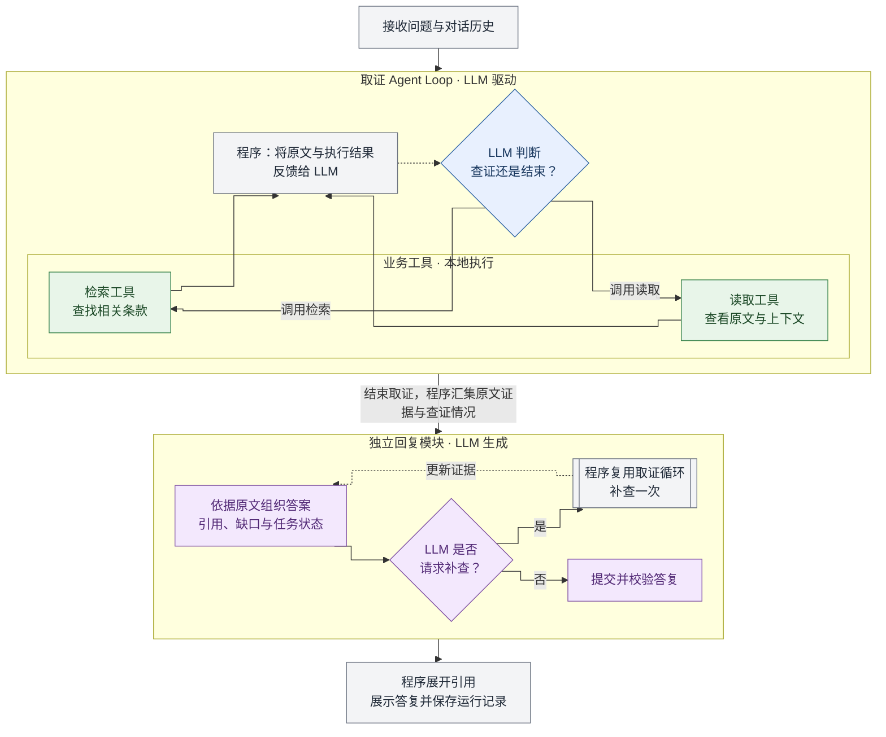

# 企业知识问答 Agent — 技术方案

## 1. 总体架构与调用流程

系统采用“一个取证 Agent Loop + 一个独立回复模块”的结构，服务范围为员工制度问答。取证循环负责理解查证目标、选择工具，判断证据是否充分、缺少哪些依据或是否存在未解冲突；回复模块接收原始证据，独立组织答案、引用、缺口和追问，判断最终任务状态。程序负责阶段切换、证据管理和执行预算。

**资料准备**


**问答调用**



两个阶段自上而下衔接，阶段内部从左向右阅读。蓝色表示 LLM 取证决策，绿色表示检索与读取工具，紫色表示 LLM 回复模块，灰色表示程序处理。虚线表示结果反馈或证据更新，双边框表示复用取证循环。补查权限由程序预先控制，是否请求补查由 LLM 决定。

图中展示正常调用流程；补查与校验机制见第 3、4 节，执行控制和硬中断处理见第 5 节。两部分共用同一模型服务，采用 OpenAI 兼容接口，默认配置为 DeepSeek `deepseek-flash`，模型名和服务地址可配置。

## 2. 模块职责

| 模块 | 实现入口 | 职责 |
| --- | --- | --- |
| CLI 与会话 | [cli.py](../src/knowledge_agent/cli.py)、[chat.py](../src/knowledge_agent/chat.py)、[session.py](../src/knowledge_agent/session.py) | 运行入口、历史导入、连续提问和会话生命周期 |
| 取证与回复协调 | [runtime.py](../src/knowledge_agent/runtime.py)、[agent.py](../src/knowledge_agent/agent.py) | 建立上下文，配置取证循环与回复模块，控制阶段切换和补查 |
| 模型接入 | [model_adapter.py](../src/knowledge_agent/model_adapter.py) | 模型请求、传输重试、上下文检查及请求记录 |
| 检索与读取 | [检索工具](../src/knowledge_agent/retrieval/tool.py)、[读取工具](../src/knowledge_agent/reading/tool.py)、[tool_binding.py](../src/knowledge_agent/tool_binding.py) | 检索排序、原文读取、分页、工具注册和执行反馈 |
| 证据与输出 | [evidence.py](../src/knowledge_agent/evidence.py)、[answering.py](../src/knowledge_agent/answering.py)、[schemas.py](../src/knowledge_agent/schemas.py) | 证据登记、原文交接、来源解析及输出结构 |
| 执行控制 | [budgets.py](../src/knowledge_agent/budgets.py)、[execution_policy.py](../src/knowledge_agent/execution_policy.py)、[output_validation.py](../src/knowledge_agent/output_validation.py) | 调用额度、超时、工具执行和输出修正 |
| 展示与记录 | [presentation.py](../src/knowledge_agent/presentation.py)、[trace.py](../src/knowledge_agent/trace.py) | 答案和引用排版，输入、输出及 Trace 保存 |

框架采用 **PydanticAI 2.64.0**，使用 `Agent`、函数工具、`RunContext`、`ToolOutput`、输出校验及 capability hooks，承担模型工具循环、参数解析、工具分派和结构化输出调度。**OpenAI SDK 3.42.0** 负责兼容接口调用。业务证据、阶段交接、预算和状态规则由项目模块管理，依赖版本见 [requirements.txt](../requirements.txt)。

取证循环和回复模块分别使用 PydanticAI 的 `Agent` 配置，拥有独立提示词及输出类型。取证阶段判断原文是否足以支持所问结论、仍缺什么以及是否存在待确认冲突，提交证据状态与停止原因；回复阶段依据原文独立组织答复、缺口及追问，判断最终任务状态。检索、读取工具只注册在取证循环；回复模块开放答案提交和有条件的补查请求。

## 3. 取证与回复设计

### 3.1 取证循环

[取证提示词](../src/knowledge_agent/research_prompt.py)围绕问题对象、适用条件和证据缺口组织决策。每次工具返回后，模型重新评估下一步；程序按模型选择执行对应工具。

| 当前信息 | 后续动作 |
| --- | --- |
| 问题明确，缺少原文 | 搜索相关条款；用户指定文档并要求阅读时直接读取 |
| 片段相关但缺少条件或上下文 | 调整查询，或读取相关章节、全文 |
| 取得相互矛盾的规定 | 继续查证适用范围、替代关系和可用线索；仍无法消解时以 `conflict` 结束，是否追问交回复模块判断 |
| 原文支持所问结论，适用关系明确且无影响结论的未解冲突 | 以 `sufficient` 结束取证 |
| 问题对象不明，或无未解冲突但缺必要个人条件 | 分别以 `unclear_question` 或 `needs_user` 结束，交回复模块澄清 |
| 合理查证后仍缺依据 | 以 `missing` 结束，交回复模块说明缺口 |
| 工具失败或部分降级 | 结合有效证据尝试替代动作；必要查证被阻断时以 `blocked` 结束 |
| 超出员工制度范围 | 以 `out_of_scope` 结束，交回复模块说明服务范围 |

取证结束通过 `finish_research` 提交原因与简短说明。工具执行和结束提交分开处理，确保模型先观察工具结果，再决定是否停止。

找到条款或收集到冲突双方不等于证据充分。即使已完成必要查证、可以交由回复阶段呈现冲突，也必须按实际缺口选择结束原因，不能因此标记为 `sufficient`。回复阶段不会将取证原因机械映射成最终任务状态。

`conflict` 只报告冲突仍未消解这一证据事实。回复阶段核对双方原文：需要用户提供适用线索时输出 `needs_info`；用户已明确没有更多线索时输出 `unresolved`。用户能否补充线索不改变取证阶段的 `conflict` 标记。

程序在接收 `sufficient` 时检查是否存在已送达模型的有效原文；没有原文则反馈校验错误，由模型重新决策，并计入共享的输出修正额度。历史答案不能通过该检查。原文是否足以支持具体结论仍由模型判断。

取证范围以用户明确询问的事项为准。仅问规则是否适用时，原文明确排除用户情形就足以结束；原文中的“另查相应制度”不会自动扩展为新的查证任务。用户同时询问实际期限等其他事项时，仍需补齐这些事项的必要依据。

例如，单份规定足以支持期限答案时，搜索后即可结束；发现 30 天与 15 天两种规定时，继续读取双方原文查证；读取失败时，可改为限定文档的搜索。对应运行过程见[实际运行记录](../examples/submission-check/cases.md)。

### 3.2 原文交接与回复

程序从证据集合中提取本轮已送达模型的原文，按文档、内容哈希及字符范围去重，组成回复输入包：

- 当前问题与对话历史。
- 原文片段、来源 ID、文档 ID、标题、版本日期及字符范围。
- 工具执行状态、错误、返回数量和分页信息。
- 取证停止原因、剩余调用额度及是否允许补查。

交接保留全部已送达的原文，包括冲突双方；取证阶段的制度概括不进入证据包。[回复提示词](../src/knowledge_agent/answer_prompt.py)据此约束结论、适用条件、引用选择、缺口和追问。

回复模块通过 `submit_answer` 提交段落及来源 ID。程序仅在首次回复、问题对象明确且未超出服务范围时，检查是否有足够预算支持补查与再次回复，并据此开放 `request_evidence`。LLM 判断仍缺可查证的必要原文时，通过该入口提出补查问题。

程序将请求交回原取证循环，随后用更新的证据包再次调用回复模块。整轮最多补查一次，补查内部可包含多次工具调用，第二次回复只提交答案。具体预算阈值见 [runtime.py](../src/knowledge_agent/runtime.py)。

## 4. 资料、检索与引用

### 4.1 资料组织

Markdown 保存制度正文，`manifest.json` 维护文档 ID、标题、版本日期和路径。`prepare` 按 Markdown 结构和固定 tokenizer 分块，生成带章节定位、字符范围及内容哈希的派生资料；原文变更后重新生成。

日常问答使用 `data/knowledge_base/`，独立验收场景使用 `data/fixtures/`，最小接入检查使用 `data/smoke/`；预生成块统一存放在 `data/prepared/`。入口显式选择资料集，检索与读取共享同一原文快照。格式和维护规则见[资料说明](../data/README.md)。

### 4.2 检索和读取工具

真实模式的正式索引默认采用 hybrid，也可选择 BM25 或 vector。BM25 使用 jieba 与 rank-bm25；向量检索使用固定版本的本地 BGE-small-zh-v1.5，在 CPU 工作进程中计算。两分支采用等权 RRF 融合排名，默认 `k=60`。

| 工具 | 参数与行为 |
| --- | --- |
| `search_knowledge` | 按 `query` 检索原文块，支持 `doc_ids` 过滤或明确 ID 定位；通过 `limit`、`cursor` 控制结果分页 |
| `read_document` | 按 `doc_id` 读取全文，或用 `section_id` / `chunk_id` 读取章节 / 块；内容过大时返回定位列表，再按定位读取 |

两个工具都接收 `purpose`，提示模型简述尚未回答的用户事项及必要原文缺口，或明确的读取请求。该字段记入Trace，不改变检索排序或读取内容；是否需要继续取证仍由模型判断。工具返回原文、定位、执行状态及错误。读取工具的 cursor 用于定位列表分页。定位用于后续查阅，原文片段用于回答依据。

混合检索某一分支失败时保留有效分支结果，以 `partial`、`errors` 和 `effective_branches` 说明情况。模型据此判断已有原文是否足够，或是否需要其他取证动作。

检索返回完整原文块；读取支持全文、章节或精确块，章节与块选择器互斥。超出返回预算时，读取工具返回 `CONTENT_TOO_LARGE` 与定位列表，定位本身不作为证据。分页游标绑定当前工具实例、资料快照和请求参数，不支持跨轮复用。缺失文档、无效参数和执行失败以明确错误反馈，工具不判断制度含义或优先级。

两个工具也提供独立 CLI，便于核对检索结果和原文。安装依赖后，在仓库根目录执行以下命令，不调用问答模型：

```sh
PYTHONPATH=src python -m knowledge_agent.retrieval search --retrieval bm25 \
  --corpus data/fixtures/F1_single_rule/manifest.json --prepared data/prepared/F1_single_rule.json \
  --query "国内差旅报销期限" --output-dir runtime/search-tool

PYTHONPATH=src python -m knowledge_agent.reading \
  --corpus data/fixtures/F1_single_rule/manifest.json --prepared data/prepared/F1_single_rule.json \
  --doc-id D01 --output-dir runtime/read-tool
```

独立工具材料保存在 `<输出目录>/<run_id>/`，记录 `model_calls=0`；正式 Agent 绑定时共享本轮证据集合与记录器。完整参数见各入口的 `--help`，资产准备见[运行说明](../README.md#准备本地检索资产)。

### 4.3 引用与结果生成

回复模块按段落提交 `text` 和 `source_ids`，程序将来源 ID 展开为文档 ID、连续原文及引用序号。不同原文跨度独立保留，标题和正文不拼接为一段引文。提交时，程序校验来源属于本轮且已送达模型，检查文档匹配、原文一致性及状态字段；校验失败时反馈模型进行有限修正。结论是否受到原文支持，由回复规则及语义验收共同约束。

| 输出状态 | 字段约束 |
| --- | --- |
| `resolved` | 有引用，`gaps` 为空，无追问 |
| `needs_info` | 提供具体的 `clarification` |
| `unresolved` | 说明缺口或服务范围，无追问字段 |
| `incomplete` | 说明必要处理被故障或执行限制阻断 |

取证停止原因用于解释过程，最终状态由回复模块结合证据判断。另以 `termination_reason` 记录程序执行的结束原因，`completed` 表示流程正常返回。

终端呈现状态、回答、必要追问、文档 ID、版本日期、原文引用和缺口。回复提示词限定内部来源 ID 只用于证据选择，程序统一生成面向用户的引用序号；内部定位与执行信息保存在 JSON/Trace 中。

## 5. 会话与执行控制

### 5.1 会话和预算

会话使用 `session_id` 关联多轮交流，每轮建立独立的 `run_id` 和调用预算。用户文本与最终答复用于理解指代及条件，已取得的原文另存于会话证据集合。

下一轮先核对资料库哈希、文档内容哈希、版本及原文位置；资料库变化时整批旧证据失效，避免漏掉新增的冲突制度。核验通过的原文以 `session_evidence` 包交给取证模型，重新分配本轮证据ID，并用 `reused_from` 保留原始证据来源，不计作新工具调用。实际送入模型后才允许引用，回复模块接收这些原文及本轮新增证据。模型根据当前问题判断是否适用、是否需要继续取证。

退出时清空历史与证据；重新启动可显式导入历史文本，但不从历史回答重建原文证据。

预算由程序统一控制，取证、回复、补查和输出修正共用额度。默认配置如下，参数定义见 [config.py](../src/knowledge_agent/config.py)。

| 项目 | 默认值 |
| --- | --- |
| 模型调用轮次 / 业务工具调用 | 10 / 16 |
| 整轮 HTTP 请求尝试 | 20，包含传输重试 |
| 输出修正 | 整轮最多 2 次 |
| 传输重试 | 每次模型调用最多额外 1 次，仍计入 HTTP 总额度 |
| 单次模型请求 / 工具执行时限 | 30 秒 / 10 秒 |
| 整轮处理时限 | 120 秒，从建立本轮执行上下文起计，不含事先资料准备及索引初始化 |

工具调用按接纳次数计数，失败、无效参数和重复调用也占用额度。达到工具硬上限后停止后续模型调用。上下文容量采用保守估算，超限时明确停止并提示缩短历史或开始新会话。

### 5.2 工具失败与硬中断

**工具失败但仍可执行：** 将错误作为观察交给取证模型，在预算内恢复或结束取证。回复模块根据原文及失败影响生成答复，可保留有据部分；必要查证未完成时返回 `incomplete`。检索降级但证据充分时，仍可正常完成回答。

**硬中断：** 模型请求无法继续、预算耗尽、整轮超时或取消时，程序停止调用，返回 `incomplete` 和对应中断说明，标记 `result_origin=runtime_fallback`。此路径使用固定模板，引用为空、缺口为通用未完成说明；已收集证据保存在 `observed_evidence` 和 Trace 中。配置、资料加载或文件保存错误由 CLI 报错。

### 5.3 离线入口与运行记录

离线 Mock 使用固定场景脚本替代模型响应，实际执行 BM25、原文读取和预算控制。用户显式选择场景，输出记录 `mode`、`mock_scenario` 和 `result_origin`；真实问答故障保持原模式。

每轮保存输入、资料快照、模型请求、工具参数与返回、会话复用证据包、原文交接包和最终输出，并用运行 ID 关联。模型请求记录标明取证或回复阶段，Trace 记录工具执行、阶段切换及结束事件。测试导出由 `artifact_export.py` 提取每轮输入、实际输出及精简Trace，`submission.py` 统一打包并按版本共用资料快照；原始调试日志留在本地。运行入口见 [README](../README.md)，验证材料与结果见[评估](03-evaluation.md)。

## 6. 技术取舍

### 6.1 轻量使用 PydanticAI

项目需要的框架能力集中在函数工具调用、类型化参数、共享上下文和结构化输出。[PydanticAI 的 Agent 抽象](https://pydantic.dev/docs/ai/core-concepts/agent/)与这些需求直接对应，项目使用 `pydantic-ai-slim[openai]` 引入所需接入能力。相较于直接用 SDK 手写循环，可复用工具协议、结果校验和修正反馈，将开发工作集中在证据与业务规则上；代价是需要遵循框架的消息和执行钩子约定。

[LangGraph](https://docs.langchain.com/oss/python/langgraph/overview)提供显式图编排、持久化执行和人工介入等能力。本项目的流程状态集中在取证、回复及一次补查，会话也只在运行期间维护，因此用普通协调代码即可表达阶段切换。选择 PydanticAI 是为了匹配当前编排规模；若后续引入跨运行恢复、人工审批或复杂分支，再考虑图编排。

### 6.2 一个取证循环与独立回复模块

取证的关注点是“原文是否充分、还缺什么依据、冲突是否消解、下一步查哪里”，回复的关注点是“哪些原文支持哪些结论、如何表达缺口、是否需要追问、问题是否解决”。拆分后可分别设置工具权限、提示词和输出契约，并由程序直接交付原文，减少交接时改写条件或遗漏冲突来源的风险。

| 其他执行方式 | 本项目的选择理由 |
| --- | --- |
| 固定的检索后生成链路 | 检索结果可能缺少范围、存在冲突或执行失败，需要按观察结果选择后续动作，因此采用动态取证循环 |
| 同一个循环直接完成查证与最终作答 | 独立回复模块使答案围绕原文和必要执行事实组织，便于单独约束引用与表达 |
| 先生成完整计划，再逐步执行 | 制度查证的下一步高度依赖刚取得的原文，逐次观察后决策更直接，也省去计划维护与重规划环节 |
| 多 Agent 分工协作 | 查证目标集中、工具只有检索和读取，单个循环便于统一证据和预算，减少任务分派及多方结论协调 |

独立回复增加一次模型调用与原文交接，带来额外延迟和上下文开销，因此两部分共享预算，并将补查限制为一次阶段往返。

### 6.3 检索、证据与运行方式

| 选择 | 设计理由与代价 |
| --- | --- |
| BM25 + 本地向量 + RRF | 结合词项和语义匹配，按排名融合两种结果；增加本地模型资产与进程管理成本，BM25 保留为可独立使用的入口 |
| 本地精确检索 | 小型合成资料便于整体加载，减少外部服务部署；资料规模扩大后需重新评估索引和查询成本 |
| 来源 ID 选择、程序展开引用 | 原文由程序管理，模型专注选择依据和生成正文；引用粒度受检索与读取返回的跨度影响，需配合语义核对 |
| CLI、Markdown 与运行记录 | 便于编辑合成制度、复现问题并追溯证据；交互与会话管理保持本地、单次运行的范围 |
