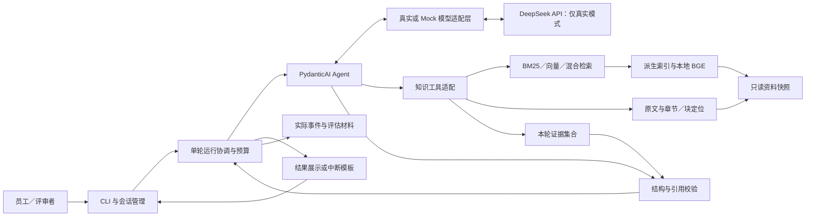
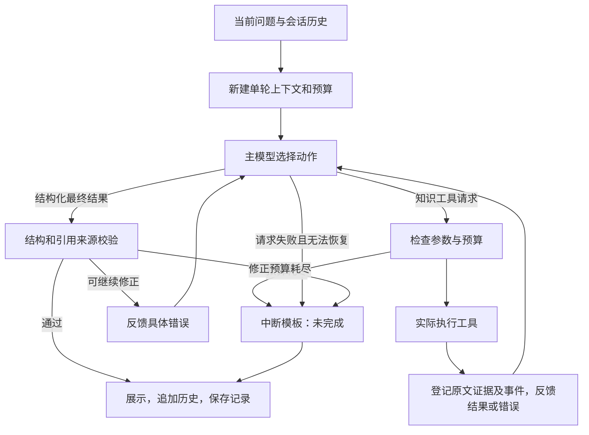
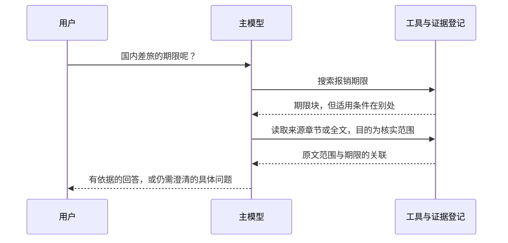
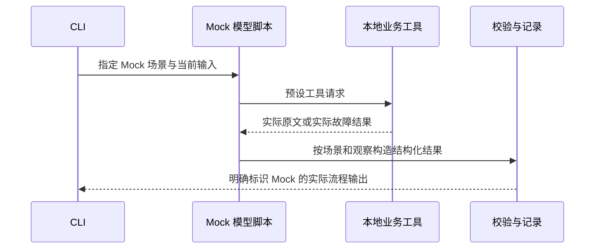

# 企业知识问答 Agent — 技术方案

更新日期：2026-11-01。设计状态：基于分轮确认形成的实现基线。初始底座、离线冒烟及一次真实模型冒烟已完成；完整接入契约与业务验收尚未完成，当前进展见下方说明。

**主循环基线阶段记录（最新进展见下方补充，不改变下文目标契约）：** 当时已建立 `src/knowledge_agent/` 组件、统一配置及 `tests/integration/smoke/`，并固定通过离线及真实模型冒烟的依赖版本。实际入口为 `smoke / config`，使用明确标识的 `smoke_fixture` 资料源；下文 `chat / prepare / evaluate` 及完整工具协议仍为待实现目标。按用户分步要求，`tests/agent_loop/contract/` 已逐步验证正常路径（3 项）及输出修正（16 项，含结构错误、引用错误、混合响应与共享修正额度）。第 3 步执行边界已验证 38 项：预算 8、传输 20、超时与取消 10；前两步 19 项与原有冒烟均回归通过。该阶段尚未实现完整工具协议、会话和业务测试；异步取消验证不代替未来本地 embedding 工作进程的超时验证。原文存储契约为 Markdown 文件＋元数据清单，保留 F1 样例。提前生成的全量用例规格、旧格式草稿和静态目录检查已清理；Q01～Q18 只保留为下文计划，后续随对应功能逐项开发和测试。单次真实冒烟不代表第 13 节第一阶段全部通过。实际命令与记录以 README 和 03-evaluation.md 为准。

需求依据：[01-requirements.md](01-requirements.md)，当前已由用户确认并定稿。本文不修改 PRD；出现需求变化时须同步确认两份文档。

**独立检索进展补充：** 上一阶段按用户要求只实现 BM25 搜索工具及其所需分块／定位，没有接 Agent 主循环。已有独立入口、固定 BGE tokenizer、原文块与快照校验、BM25 过滤／精确 ID／分页／错误契约。测试只直接调用工具：冒烟 2、契约 38、业务 7 项通过；F1／F2 原文及正式离线块已准备。F1 两种问法的支持条款均在第 3 位，完整效果与限制见评估文档。这不改变后续向量／混合检索、会话及完整 Agent 验收目标。

**独立读取进展补充：** 上一阶段已实现 `reading/` 的全文／章节／块读取、选择器校验、超限局部定位与每页 20 项的游标、原文证据登记和独立 CLI。与搜索共用快照、ID 和证据协议，直接调用工具验证了从搜索块扩展到所属章节取得适用范围；新增 R1 专项原文与正式派生块。读取冒烟 3、契约 23、业务 7、边界 14 项通过，搜索回归 47 项通过。当时尚未接入 Agent、未调用模型。独立入口、记录方式和边界见 [读取组件说明](../src/knowledge_agent/reading/README.md)。

**正式工具 FC 接入进展：** 本阶段使用 PydanticAI 标准函数工具注册，SearchRequest／ReadRequest 生成公开参数 schema，框架负责调用解析、校验、执行与反馈。IndexedCorpus 将真实 BM25 和读取组件接入相同的 Agent／运行器，两个工具共用当轮快照、证据与日志；CLI 通过 --prepared 显式启用。12 项框架接入、2 项实际 SDK＋本地 HTTP 协议测试通过；既有测试回归 156 passed／1 skipped。新增测试仅验证工具定义→FC→实际工具→观察反馈，不产生业务终态；没有真实模型请求，不计为真实 ReAct 或 Q01～Q18 的 E2E 验收。记录见 [FC 接入索引](../examples/integration/tool-calls.md)。

下文中的接口、目录、命令、参数与示例是**目标契约**；已有实现以以上进展和运行说明为准。预期路径不是实际 Trace，不能作为考核通过证据。实际结果、失败及材料链接应记录在 [03-evaluation.md](03-evaluation.md)。

## 1. 设计目标与已确认决策

目标是完成可靠的员工制度问答：真实模型根据工具观察决定行动，答案可追溯到当前资料；资料不足、冲突或执行故障时诚实结束。优先实现可验收核心链路，再根据失败改进；性能优先关注整轮等待时间。

| 方面 | 设计决定 | 取舍与边界 |
|---|---|---|
| 入口 | Python CLI，进程内连续对话，可显式导入历史 | 不建设网页、长期会话存储或资料管理界面 |
| Agent | 单 Agent，PydanticAI 提供模型与工具循环 | 不自行重写框架；业务决策由主模型承担 |
| 主模型 | DeepSeek 官方 API，`deepseek-flash`；首版明确关闭 thinking | 使用真实工具调用；真实请求失败不静默切换 Mock |
| Embedding | 本地 `BAAI/bge-small-zh-v1.5` | 中文小规模资料的初始选择；需下载、缓存权重并实测效果 |
| 检索 | BM25、向量、混合三种 CLI 模式，真实模式默认混合 | 同一工具、同一资料块，便于比较；首版不加精排 |
| 知识组织 | 原始文档、章节定位、原文块 | 结构边界与 token 约束结合，必要时重叠；不生成 Wiki |
| 业务工具 | `search_knowledge`、`read_document` | 搜索返回块和定位元数据；读取支持文档／章节／块 |
| 语义职责 | 主模型判断相关性、条件、冲突、证据充分性及业务状态 | 程序不使用关键词或数值规则裁决制度 |
| 程序校验 | 数据结构、明确字段约束、来源及引用一致性 | 不保证引用支持结论；失败反馈主模型有限修正 |
| 在线审核 | 首版不增加独立审核模型 | 用真实评估发现语义缺陷，后续按证据决定是否增加 |
| 历史 | 保留用户消息和最终回答；本轮工具证据独立管理 | 历史用于理解意图，不能代替重新查证 |
| 故障 | 工具错误交回模型；API 临时故障有限重试；无法继续时固定模板兜底 | 自动重试与模板不算 ReAct 决策 |
| 离线 | 显式 Mock 模型适配层＋实际本地工具，基础演示使用 BM25 | 预设场景只验证流程，不证明模型能力 |

### 1.1 文档与实现的完成边界

本文确定模块职责、数据链路、接口、预期分支与验证判据。以下不是已验证事实：DeepSeek 在本题上的决策质量、BGE 的召回效果、依赖组合兼容性、参数是否足够、端到端耗时。

实现阶段须锁定实际使用的 Python 与依赖版本，执行第 13 节的接入检查及验收。不能以“框架支持工具调用”替代真实执行验证，也不能将尚未生成的 examples 文件描述为存在。

## 2. 系统边界与技术架构

外部依赖只有真实模式下的 DeepSeek API，以及显式准备 tokenizer／embedding 权重时的模型下载源。运行中的业务知识全部来自选定的本地合成资料快照，不调用网络搜索，不接入真实企业系统。



| 模块 | 职责 | 不承担的职责 |
|---|---|---|
| CLI／Session | 参数解析、读取问题、导入和追加历史、退出 | 判断制度适用条件、强制续接旧问题 |
| Run Coordinator | 建立单轮上下文、执行预算、协调校验与终止、保存记录 | 根据搜索命中数推断业务状态 |
| PydanticAI Agent | 工具注册、模型消息交换、结构化结束及校验反馈 | 自动保证语义正确或自动完成全部验收 |
| Model Adapter | DeepSeek 请求、可控传输重试、Mock 替换 | 在真实故障时伪造模型下一步 |
| Corpus／Chunker | 原文加载、结构定位、token 切分、内容指纹 | 用 LLM 改写制度或预先写入冲突答案 |
| Retrieval | BM25、向量匹配、RRF 融合、分页和部分失败报告 | 选择权威制度、以分数代表正确率 |
| Knowledge Tools | 参数检查、调用服务、来源包装、证据登记 | 强制每题搜索后再读取 |
| Evidence／Validator | 核对已取得来源与引用文字、检查字段约束 | 判断引用是否足以推出结论 |
| Trace／Evaluation | 记录执行事实、运行比较、验收归因 | 将预期路径填充成真实日志 |

两个业务工具之外，框架可能以输出工具表示结构化终态；这是输出协议，不是第三个知识工具。首版不增加独立追问工具、冲突判断工具、精排工具或审核 Agent。

### 2.1 技术组件与版本管理

| 组件 | 拟采用方式 | 版本状态 |
|---|---|---|
| Python | 以 3.11 作为初始环境 | 本机 3.11.15 已通过安装与离线冒烟 |
| PydanticAI／Pydantic | Agent、函数工具、结构化结果、校验反馈、运行消息及事件 | 当前冒烟环境为 2.64.0／2.14.2；已记录依赖，完整接入检查仍待完成 |
| DeepSeek | 官方 provider，`deepseek-flash`，非流式输出，thinking 明确关闭 | 记录请求别名、响应模型标识与运行日期；别名可能更新 |
| BM25 | `rank_bm25`，查询与块使用相同的 `jieba` 分词规则 | 当前 rank-bm25 0.2.2／jieba 0.42.1；版本、词典及预处理配置已纳入索引指纹 |
| BGE | `sentence-transformers` 加载本地模型；按官方用法处理查询指令、归一化 | 锁定模型 revision、tokenizer revision 和依赖版本 |
| 向量存储 | 本地向量数组与精确余弦相似度；不部署向量数据库 | 记录 dtype、维数和块顺序 |
| 测试 | `pytest`＋CLI 集成运行＋真实模型评估脚本 | pytest 9.2.0；已有主循环契约和独立检索三层测试，完整真实评估脚本待实现 |

RRF 根据排名融合不同检索列表，不直接相加不同量纲的原始分数。组件选择依据见第 16 节；工程参数为初始默认，效果须实测。

## 3. 数据模型、资料快照与存储

### 3.1 原文与派生对象

每套资料由 `manifest.json` 元数据清单及独立的 `documents/*.md` 原文组成。清单固定为 `{schema_version: 1, documents: [...]}`；每项仅包含 `doc_id`、`title`、`version_date`、`source_path`，不存 body。source_path 相对于清单目录，只能指向目录内的 Markdown 文件；禁止绝对路径、向上跳转和符号链接越界。ID 与解析后的路径在资料集中唯一；版本日期必须有效，未知字段拒绝加载。

Markdown 文件是唯一正文来源；使用明确标题、段落、编号条款，不要求复杂格式，也不解析 front matter。加载层严格按 UTF-8 解码，不变更换行或空白，再将原文及元数据组装为内部 Document。Document.body 是原文的内存表示，不是另一份可编辑数据源。加载不接受旧的内嵌 body JSON 数组。内部快照可以序列化为 JSON，用于复核当时实际取得的正文。详细约定见 [资料存储契约](../data/README.md)。

| 对象 | 关键字段 | 约束 |
|---|---|---|
| Document | `doc_id, title, version_date, body, content_hash` | ID 在资料集中唯一；日期合法；正文非空；日期不代表优先级 |
| Section | `doc_id, section_id, heading, start, end` | 从原文标题解析；section_id 为非空字符串；无标题时建立全文根章节；位置对应正文 |
| Chunk | `chunk_id, doc_id, section_id, start, end, heading_span, text` | `text == body[start:end]`；来源版本由 manifest 关联 |
| CorpusManifest | `corpus_hash, documents, chunker_config, tokenizer_revision, schema_version` | 文档内容或解析配置变化使派生块失效 |
| IndexManifest | `corpus_hash, chunks_hash, bm25_config, embedding_config, vector_shape` | 各模式只使用与快照匹配的索引；配置不同不得混用 |
| SessionMessage | `role, content` | 仅 user／assistant；不接受导入的 system／tool 消息 |
| TurnContext | `run_id, question, history, corpus_hash, budgets, evidence, events` | 每个问题新建；工具消息和证据不跨轮复用 |

位置统一采用 Python 字符串的 Unicode 字符偏移，区间为左闭右开，不使用字节偏移。解码后的 `body` 原样保存；分词及向量预处理不修改供引用的原文。块 ID 只在对应 `corpus_hash` 内解释，不能认为文档改动后同名 C01 仍是相同内容。

无 Markdown 标题的文档统一建立根章节 `<doc_id>-ROOT`，范围为 `[0, len(body))`；例如 D01 的根章节为 D01-ROOT。加载、分块、检索返回、读取返回及局部定位均沿用同一章节 ID，不对外改成 null。此时 heading／section_heading 和 heading_span 为 null，因为原文没有章节标题；文档元数据 title 不冒充原文章节标题。根章节只是定位结构，不向原文插入“全文”等虚构标题。read_document 的输入 section_id=null 仅表示未指定章节筛选，与返回记录必须具有章节 ID 不矛盾。

章节标题可包含适用范围，因此搜索返回所属标题时同时保留其 `heading_span`。标题与块正文是两个真实来源片段，不拼接成一段原文引用。引用跨越不连续片段时应拆成多条。

### 3.2 资料生命周期

1. 启动时读取选定资料集，检查文档身份、日期、正文、结构和 manifest。
2. 加载或构建派生块、BM25 及所需向量数据；先核对指纹，不能使用旧索引响应新原文。
3. 运行期间使用内存中的一致快照；不热更新文件。读取工具与搜索工具都访问这份快照。
4. 修改资料后重新启动。缓存不匹配且依赖齐备时重建；否则明确要求准备资料，不悄悄使用旧数据。
5. 评估记录保存本次资料快照／manifest，以便重现；同一对比实验使用相同资料与块配置。

测试配置可以选择不同资料集，但用例类别、预期答案、故障时刻等控制信息不传给真实模型。不存在一套同时包含所有互斥示例规定的默认验收资料。

### 3.3 离线所需的派生块

基础 Mock 使用 BM25，不加载 BGE 权重，也不在运行时下载 tokenizer。随固定演示资料提供由正式分块流程生成的块与 manifest；启动时仅核对哈希、位置及正文一致性，再建立 BM25。

这样离线演示可在基础依赖已安装、无 API 密钥、无模型权重和无网络的环境中执行。修改演示原文后，旧块不再有效：需显式运行准备命令并获得 tokenizer 文件。不能为了继续演示而换一套未标识的分块方式。向量／混合模式及正式重分块测试需要额外的本地模型或 tokenizer 缓存。

当前已为独立搜索生成 F1、F2 派生块；它们尚未替换原 Agent Mock 的 smoke_fixture。分块实际使用 tokenizers 0.22.1 和 BGE tokenizer revision `7999e1d3359715c523056ef9478215996d62a620`，校验文件 SHA-256，准备命令显式下载 tokenizer，不下载模型权重。现阶段 BM25 索引启动时从块重建，只持久化块与索引身份记录，不持久化排名索引文件。

独立读取阶段新增 R1 派生块，使用相同默认分块参数与 tokenizer，期限和适用范围位于同一 Section 的不同块。它仅用于组件补读验证，不改变 F1～F6 的业务验收定义。

## 4. 分块与检索设计

### 4.1 结构边界与 token 预算结合

段落或条款是优先边界，不是不能再拆的最小单位。分块算法只处理显式文本结构、位置与长度，不理解制度含义。

1. 先按章节划定范围，默认不跨章节合并正文。
2. 将相邻短段落／条款合并，接近目标长度时在已有边界结束。
3. 长段落优先按句子边界细分；单句仍过长时按 tokenizer 的原文位置窗口拆分。
4. 由于长度拆开的相邻块可保留尾部重叠；优先完整尾句，受重叠预算约束。短且完整的章节不强行重叠。
5. 最终验证标题上下文、正文和特殊 token 组成的 embedding 输入没有超过上限；禁止静默截断。

初始目标为每块索引输入约 320 tokens，硬上限 480 tokens（含标题与特殊 token），重叠最多 48 tokens。BGE tokenizer 上限为 512；使用实际 tokenizer 计数，不用汉字数替代。标题过长时缩短仅用于索引的标题上下文并记录处理；原始标题不变。无法在预算内形成有效块时准备阶段报错。

块正文保留原文精确范围，索引文本可以组合文档标题、章节标题和正文用于匹配，但这种组合不是可直接引用的连续原文。切块后检查所有正文均被覆盖且窗口前进，避免漏字、死循环和超限块。重叠引用按来源位置去重，不视为多份独立证据。

### 4.2 BM25 与向量检索

- BM25：索引与查询使用一致的中文分词和轻量预处理；保留数值、期限、否定与范围相关词，不做激进停用词删除。候选需有词项重合；不能简单用 BM25 分数大于零作为是否命中的统一标准。
- 向量：预先编码块，问题到来时编码查询，使用相同 BGE revision 与归一化规则，精确计算余弦相似度。按官方配置仅对查询应用检索指令，不重复添加。查询超出输入上限时反馈 `QUERY_TOO_LONG`，让主模型缩短查询，不能静默截断。
- 向量近邻只是候选；初始不设未经校准的语义阈值。模型可认为所有返回块都无关，继续搜索或说明现有资料没有找到支持。
- 不将版本较新、数值较小、匹配分数较高转换成制度优先级。

### 4.3 混合、候选数量与扩展

BM25 和向量搜索使用同一资料与块集合。当前资料很少，内部计算过滤范围内的完整候选排名：BM25 仅纳入有词项重合的块，向量分支纳入可计算的块，再按 RRF 等权融合，常数初始为 60。相同块去重；不同文档即使文字相似也保留来源，不合并掉可能的冲突证据。内部计算完整排名不等于把全部正文发给模型。

默认向模型返回前 5 个块，每页最多 10 个。工具提供不透明分页 cursor：它绑定同一快照、查询、过滤条件及本次固定的候选排序，翻页不重新扩大候选窗口并重排，以免重复或遗漏。排序并列时按稳定块标识确定顺序。`has_more=false` 只表示本次候选列表已读完，不能证明知识库没有其他有效规定；例如 BM25 未匹配的同义条款可能从未进入列表。将来扩大资料规模时可限制召回窗口，但须同步记录覆盖边界并重新评估。

分页与返回量限额以执行配置为准；主模型决定是否翻页、改写查询或读取。程序不要求遍历全库，也不因只返回一个文档就宣称没有冲突。召回不足、同文档块挤占结果、冲突另一方被排到后面均是独立评估问题。

当前独立实现的游标只在同一 SearchTool 实例存活期间有效，最多保留 256 项（可配置），超额淘汰最早项，失效值明确报 INVALID_CURSOR；不提供跨进程恢复。按全快照计算 BM25 词频统计，在过滤范围内排序候选，purpose 不参与排名。分块支持 ATX 标题并跳过围栏代码中的标题标记；其他文本保留为原文，不宣称完整 Markdown AST 支持。独立工具的完整使用约定见 [retrieval/README.md](../src/knowledge_agent/retrieval/README.md)。

### 4.4 分支故障

混合检索中一个分支失败、另一个成功时，返回成功分支结果及明确的 `partial` 执行状态；`requested_mode=hybrid` 与 `effective_branches` 同时记录。成功分支没有候选但另一分支失败，仍是 `partial`，不能表述为全体检索成功但无资料。

全部必需分支失败时返回 `error`。单独 vector 模式失败时不自动改成 BM25；真实模型失败时也不改成 Mock。主模型根据工具执行信息和已有原文决定后续业务行动。检索服务不会直接把部分故障映射为“已解决”或“未完成”。

若 BGE 权重在初始化时不可用，混合模式可在显式告知用户、记录原因后以向量分支不可用的状态启动；后续每次搜索仍报告 `partial`。此运行不能计入完整混合检索性能。vector-only 模式无法初始化则报启动错误并退出。

## 5. 工具契约与证据登记

### 5.1 公共规则

当前框架绑定位于 tool_binding.py：使用 agent.tool 注册 name、description、sequential=True，带 RunContext 的函数只接受一个既有 Pydantic 请求模型参数。锁定版本会将其字段展开为顶层工具参数，不向模型暴露 ctx、request 包装层或程序 call_id。每轮模型请求均由框架／SDK附带工具定义；模型通过原生 function call 指定名称、JSON 参数和调用 ID，由框架路由，不在提示词中自建 JSON 指令协议。

框架在派发前校验参数，类型／范围／互斥等错误通过其标准工具反馈交回模型；无效请求仍按主循环约定计入已接纳调用次数，不执行底层工具。合法请求调用原有 SearchTool／ReadTool，不复制检索或读取逻辑。工具语义错误继续使用原有返回信封。接入使用 standalone=False，工具只记录调用／返回和证据；整轮 input/output 归运行器，tool_started 归执行钩子，避免覆盖或重复计数。每个问题新建两个工具实例，保留同轮分页状态，不跨轮复用游标或证据。

两个工具都是本地只读工具。主模型每次请求附带简短 `purpose`，描述行动目的，不要求内部思维链；它只进入 Trace，不影响检索排序。工具参数、调用数、返回大小均由程序检查，错误是下一步模型可以观察的数据。

工具返回状态为 `ok | empty | partial | error`，与四类业务结果状态严格分开。程序生成统一返回结构，模型不能自行填写或改变：

| 字段 | 契约 |
|---|---|
| `schema_version, tool, tool_call_id, corpus_hash` | 协议版本、工具名、调用 ID、不可变资料快照身份 |
| `status` | `ok`：本次执行成功且有正文；`empty`：本次执行成功但无正文；`partial`：仍有可成功执行的部分，但某个 ID 或检索分支失败，即使正文为空也用此状态；`error`：请求无法执行、全部目标／分支失败，或读取对象超过单次正文预算 |
| `data` | 固定包含 `hits, segments, locators` 三个数组；搜索填 hits，读取填 segments，超大读取填 locators；不适用项为 `[]` |
| `errors[]` | 每项为 `{code, message, retryable, target}`；target 为 null 或 `{kind, id}`，kind 为 `doc / section / chunk / branch / cursor`；错误不含凭证或完整异常栈 |
| `execution` | 固定包含 `strategy, requested_mode, effective_branches, next_cursor, has_more, return_limited`；读取 requested_mode 为 null、effective_branches 为 []；错误详情统一放 errors |

`retryable` 仅表示原参数重试是否可能恢复，不表示程序必须重试，也不妨碍模型改参数或改用局部读取。`has_more` 与 `next_cursor` 成对：有后续项时为 true 和非空游标，否则为 false 和 null。游标是程序生成的不透明值，绑定工具名、快照、查询／选择器、limit、实际排序与已消费位置；不能跨工具使用。

列表分页成功仍可为 `ok`，不因“还有下一页”变成 `partial`；`partial` 专指执行故障。`return_limited=true` 表示正文预算或局部定位列表上限限制了本次返回，不代表业务资料不足。无效参数或游标不执行检索／读取，返回 error。

有效原文返回后登记证据，并记录 `delivered_to_model`：已执行并保存在程序中的资料，与实际发送给下一次模型请求的资料可区分。模型最终引用必须来自本轮已反馈给模型的证据；中断展示则可保留已经取得、尚未反馈的资料并注明。

### 5.2 search_knowledge

拟定参数：

```text
search_knowledge(
  query: str,
  purpose: str,
  doc_ids: list[str] | null = null,
  limit: int = 5,
  cursor: str | null = null
)
```

| 参数／返回 | 契约 |
|---|---|
| `query` | 正常搜索须非空；仅按明确 `doc_ids` 定位时允许空查询，返回对应文档的首批原文块 |
| `doc_ids` | null 表示不限定；显式 [] 为 INVALID_ARGUMENT；重复 ID 按首次出现去重。部分 ID 不存在时继续搜索有效 ID，返回 partial 并逐个报告 NOT_FOUND；全部不存在则 error。不做模糊替换 |
| `limit` | 1～10；超过上限返回参数错误，而不是静默忽略 |
| `cursor` | 下一页须沿用原查询与过滤；快照或参数不匹配时返回 `INVALID_CURSOR` |
| `data.hits[]` | 每项包含 `evidence_id, doc_id, title, version_date, content_hash, section_id, section_heading, chunk_id, source_span, text`；附真实标题位置用于引用 |
| `execution` | strategy 为 bm25、vector、hybrid 或 id_lookup；分页遵守 §5.1；不返回完整章节目录 |
| `errors[]` | 文档缺失和检索分支故障均按 §5.1 标注 target；不把分支故障当作空结果 |

`source_span` 为 `{start: int, end: int}`，以原文 Unicode 字符计数、左闭右开；日期为 ISO 日期字符串。`query + doc_ids` 表示在指定文档内搜索；空查询加明确 ID 时按请求 ID 顺序、文档内原文顺序精确定位，`execution.strategy=id_lookup`，effective_branches=[]，不伪装为实际执行了向量检索。

搜索按完整原文块装入页面，先达到 limit 或正文预算即停止，不截半块。游标指向首个尚未返回的候选，而非按请求 limit 跳过候选；模型沿用 query、doc_ids、limit 并传 next_cursor 继续。若首块连同其可引用标题已超过预算，则返回 RETURN_BUDGET_TOO_SMALL、空 hits、无游标，明确要求调整配置，不返回永不前进的空页。准备资料时检查块可单次读取，启动时拒绝与现有块不兼容的过小返回预算。

游标延续已建立的排名及实际分支集合；部分故障页面的后续页仍报告同一故障，不因翻页悄悄重算。模型若要恢复失败分支，须不带游标重新发起检索。存在有效 ID 但没有候选且另有 ID 缺失时为 partial，不是 empty；有效 ID 均成功、无候选且没有错误才为 empty。

文档 ID 精确定位属于工具内部确定性查找，不受 BM25 或向量相关性影响。提供 D03 线索时，模型可以先用 `query="", doc_ids=["D03"]` 搜索定位，再按实际证据读取其章节。

`empty` 只表示本次成功执行的查询没有候选，不表示制度不存在。返回条数、分数以及分页结束均不是业务完整性的证明。摘要不替代原文块；工具反馈给模型的实际内容也存入运行材料。

### 5.3 read_document

拟定参数：

```text
read_document(
  doc_id: str,
  purpose: str,
  section_id: str | null = null,
  chunk_id: str | null = null,
  cursor: str | null = null
)
```

- 仅 `doc_id`：读取该短文档全文，按原章节顺序返回可定位的原文片段。
- `doc_id + section_id`：读取该章节标题及正文。
- `doc_id + chunk_id`：读取指定块及所属标题的精确来源片段。
- `section_id`、`chunk_id` 互斥；检查从属关系，禁止跨文档混用 ID。
- execution.strategy 为 `document | section | chunk`；data.segments 每项包含 evidence_id、doc_id、title、version_date、content_hash、section_id、chunk_id（非块读取可为 null）、source_span、text。全文由全部连续段构成，不由模型重组。
- 未知 ID 返回 `NOT_FOUND`；参数不合法返回 `INVALID_ARGUMENT`；实际读取故障返回 `READ_FAILED`。不存在某个 ID 不代表没有对应制度。
- 全文／章节超出正文预算时返回 error、CONTENT_TOO_LARGE、segments=[] 和 data.locators，不夹带截断正文。locator 为 `{doc_id, section_id, chunk_id, source_span, read_args}`；read_args 仅含 `{doc_id, chunk_id}`，模型补 purpose 即可读取。定位项不是证据，不生成 evidence_id。
- locators 按原文顺序每次最多 20 项，只列当前选择器覆盖的块；跨章节块禁止产生。还有定位项时提供 next_cursor；模型沿用 doc_id、section_id／chunk_id 和 cursor 继续取得定位页，状态仍为 error 且错误仍为 CONTENT_TOO_LARGE，因为原全文读取请求未完成。局部正文须另以 chunk_id 读取，且不带该游标。
- cursor 仅用于超大读取的定位列表续页，不表示全文已经分批读完。变更选择器、跨快照、用搜索游标读取或对普通短文读取传无效游标均返回 INVALID_CURSOR。超大块由前述准备／配置检查阻止，不形成“读块仍要求读同一块”的恢复死循环。

没有必要为追问单设阻塞工具；追问作为本轮结果返回给 CLI。程序不提供可直接裁决制度的 `resolve_conflict` 工具。

当前独立读取实现沿用搜索的正文计量：返回各段 text 与 section_heading 字符数求和，包含重复标题字段。locator 游标只在当前 ReadTool 实例有效，默认最多 256 项，由 read_cursor_capacity 配置，超额淘汰最早项。单块不兼容的预算在启动时拒绝，调用层另返回 RETURN_BUDGET_TOO_SMALL 防御错误，不生成递归读同一块的定位。

### 5.4 Evidence 与引用

证据登记由程序执行，包含：`evidence_id, run_id, tool_call_id, corpus_hash, doc_id, content_hash, source_spans, observed_text, delivered_to_model`。章节标题与正文可登记为不同 span，不能把不连续片段拼接成一条引文。

最终引文包含 `evidence_id, doc_id, quote`，程序补充版本日期和来源定位。引文必须是该证据中某个原文 span 的非空连续子串；同时核对本轮身份和快照版本。不得只凭文档 ID 存在就接受引用，也不得用模型生成的摘要替换原文。

整篇读取可支持多个来源明确的引文。不同重叠块里的同一出处不构成独立佐证。没有本轮有效证据时，`citations=[]` 并在展示中明确无有效引用。

### 5.5 返回结构示例

以下为接口说明，哈希和游标使用示意值，非实际运行记录；每例属于独立调用。错误例为突出续页行为，设定位页容量为 1，其余默认容量为 20。purpose 在调用时均须提供，此处省略调用目的文字。

**成功：query="", doc_ids=["D01"]**

```json
{
  "schema_version": 1,
  "tool": "search_knowledge",
  "tool_call_id": "T1",
  "corpus_hash": "demo-corpus-hash",
  "status": "ok",
  "data": {
    "hits": [
      {
        "evidence_id": "E1",
        "doc_id": "D01",
        "title": "差旅报销制度",
        "version_date": "2026-01-01",
        "content_hash": "demo-D01-hash",
        "section_id": "D01-ROOT",
        "section_heading": null,
        "heading_span": null,
        "chunk_id": "D01-C01",
        "source_span": {
          "start": 0,
          "end": 22
        },
        "text": "国内差旅报销须在行程结束后 30 天内提交。"
      }
    ],
    "segments": [],
    "locators": []
  },
  "errors": [],
  "execution": {
    "strategy": "id_lookup",
    "requested_mode": "bm25",
    "effective_branches": [],
    "next_cursor": null,
    "has_more": false,
    "return_limited": false
  }
}
```

**空结果：query="育儿假", doc_ids=null，BM25 成功但无候选**

```json
{
  "schema_version": 1,
  "tool": "search_knowledge",
  "tool_call_id": "T2",
  "corpus_hash": "demo-corpus-hash",
  "status": "empty",
  "data": {
    "hits": [],
    "segments": [],
    "locators": []
  },
  "errors": [],
  "execution": {
    "strategy": "bm25",
    "requested_mode": "bm25",
    "effective_branches": [
      "bm25"
    ],
    "next_cursor": null,
    "has_more": false,
    "return_limited": false
  }
}
```

**部分失败：query="", doc_ids=["D01", "D99"]，D01 存在而 D99 不存在**

```json
{
  "schema_version": 1,
  "tool": "search_knowledge",
  "tool_call_id": "T3",
  "corpus_hash": "demo-corpus-hash",
  "status": "partial",
  "data": {
    "hits": [
      {
        "evidence_id": "E3",
        "doc_id": "D01",
        "title": "差旅报销制度",
        "version_date": "2026-01-01",
        "content_hash": "demo-D01-hash",
        "section_id": "D01-ROOT",
        "section_heading": null,
        "heading_span": null,
        "chunk_id": "D01-C01",
        "source_span": {
          "start": 0,
          "end": 22
        },
        "text": "国内差旅报销须在行程结束后 30 天内提交。"
      }
    ],
    "segments": [],
    "locators": []
  },
  "errors": [
    {
      "code": "NOT_FOUND",
      "message": "文档 D99 不存在于当前快照。",
      "retryable": false,
      "target": {
        "kind": "doc",
        "id": "D99"
      }
    }
  ],
  "execution": {
    "strategy": "id_lookup",
    "requested_mode": "bm25",
    "effective_branches": [],
    "next_cursor": null,
    "has_more": false,
    "return_limited": false
  }
}
```

**错误：read_document(doc_id="D10")，全文超限并提供第一批局部定位**

```json
{
  "schema_version": 1,
  "tool": "read_document",
  "tool_call_id": "T4",
  "corpus_hash": "demo-corpus-hash",
  "status": "error",
  "data": {
    "hits": [],
    "segments": [],
    "locators": [
      {
        "doc_id": "D10",
        "section_id": "D10-S01",
        "chunk_id": "D10-C01",
        "source_span": {
          "start": 0,
          "end": 480
        },
        "read_args": {
          "doc_id": "D10",
          "chunk_id": "D10-C01"
        }
      }
    ]
  },
  "errors": [
    {
      "code": "CONTENT_TOO_LARGE",
      "message": "全文超过正文预算，请按块读取；尚有后续定位项。",
      "retryable": false,
      "target": {
        "kind": "doc",
        "id": "D10"
      }
    }
  ],
  "execution": {
    "strategy": "document",
    "requested_mode": null,
    "effective_branches": [],
    "next_cursor": "opaque-D10-locator-page-2",
    "has_more": true,
    "return_limited": true
  }
}
```

错误例继续调用 `read_document(doc_id="D10", purpose="列出后续可读块", cursor="opaque-D10-locator-page-2")`；读取已知块则调用 `read_document(doc_id="D10", chunk_id="D10-C01", purpose="取得局部原文")`，不带定位游标。只有后者的 segments 原文可登记为证据。

搜索正文预算提前触顶时，例如 limit=5 但仅装得下排名前 2 块，仍返回这 2 块、return_limited=true，游标从第 3 块开始；不得从第 6 块开始。参数非法、全体 ID 缺失、全部分支故障与无效游标使用同一 error 信封，data 三个列表为空且无续页游标。

## 6. 主模型循环、结果协议与会话

### 6.1 输入与决策边界

每轮向主模型提供：应用指令、当前问题、允许的会话历史、两个工具的契约及剩余预算说明。业务资料与工具返回是证据数据，不可覆盖系统指令。真实模型不接收用例标签、预期状态、预期答案或 Mock 脚本。

提示词明确以下行为：

- 历史只用于理解指代、当前诉求及用户提供的条件。条件更正后重新判断，话题切换后处理新问题；无法判断关系时追问。
- 制度结论只依据本轮取得的预置资料。用户自述个人范围可用于匹配，用户宣称制度优先级、粘贴库外制度或历史助手引用不能直接成为权威依据。
- 对检索候选判断相关性与充分性；必要时改写查询、翻页、按文档线索定位或读取原文。不保证每个问题都使用工具。
- 不同规定已有明确范围解释且用户条件明确时，可以直接回答；真正无法解释的矛盾须继续查证，查不到依据则保留冲突与双方引用。
- 问题含多项诉求时，允许先回答有依据部分，并标明剩余缺口，不标为全部解决。
- 检索失败不等于资料不存在；向量分数不代表权威、正确率或有无冲突。
- 不需要长篇计划或内部思维过程；工具目的、最终决策摘要仅说明可观察的行动依据。

主模型选择业务行动，程序仅处理协议与执行事实。没有“发现数字不同则冲突”“新日期覆盖旧日期”“看到冲突关键词强制再搜索”等代码分支。

### 6.2 运行骨架



工具结果反馈给主模型后，下一动作可以是任一合法工具或终态，不把图画成每轮固定的“搜一次、读一次、答一次”。真实语义决策必须在 Trace 中来自真实模型响应。

正常结束接受经过校验的模型结果。同一模型响应同时请求业务工具和提交终态时，不能在尚有待执行请求、且模型尚未观察这些新结果的情况下接受该终态。

**已确认 D1：混合响应的唯一处理策略。** 拒绝该次终态、在预算内执行合法业务工具，将各工具结果与终态拒绝原因一起反馈，要求下一次模型响应再决定结束或继续。不接受同批工具执行前生成的答案，也不将整条混合响应一律丢弃。预算耗尽时直接输出未完成。

当前官方文档说明：Tool Output 用输出工具承载结构化结果；同响应的函数工具与输出工具由 end_strategy 协调。执行了函数工具不等于模型一定再次观察其结果，因此不能只设置 graceful／exhaustive 就宣称满足上述约束。接入验证以非流式、thinking 关闭、显式 ToolOutput 为候选组合，验证失败不得静默改为宽松文本解析。目前该组合已通过一次普通真实冒烟并记录版本；第 2 步使用受控模型验证混合响应的拒绝、工具观察反馈及输出修正额度边界。与模型／工具总预算、超时等共同作用的边界仍待第 3 步验证，不能用普通冒烟代替。

收到混合响应已消耗本次模型逻辑轮次和实际 HTTP 尝试；拒绝终态计入全轮共享的输出修正预算，后续模型请求另计一轮，实际接纳的业务调用逐项计数。工具请求和成功结果都不能重置预算，框架重试也不能重开一轮计数。

最多允许 2 次输出修正反馈：例如连续三次响应都是“工具＋终态”，前两次可执行工具并各反馈一次，第三次仍不合法时直接 incomplete，不再执行其工具，也不追加模型总结。若第 3 次为合法独立终态且其他预算允许，仍可正常结束。模型改为持续只调工具时，仍受 10 次模型轮次、16 次工具尝试、20 次 HTTP 尝试与 120 秒整轮上限约束。

接纳混合响应中的工具前须确认尚有输出修正额度和后续模型请求额度；否则直接中断。反馈说明只需纠正协议：“本次结果未被接受；请观察工具反馈后决定继续调用工具或单独提交最终结果。”程序不自行判定检索是否有语义进展，也不把重复参数直接等同于死循环。此设计保证有界停止，不保证模型一定修正成功；需用持续混合响应、持续工具调用和最后一次修正成功三类受控测试验证。

当前实现使用 PydanticAI 的 `before_output_validate`／`on_output_validate_error` 能力钩子及 output_validator，保留框架的解析和校验反馈。应用层在 TurnContext 中维护共享输出修正计数；响应适配层识别混合响应，在接纳业务工具前预留一次修正额度，再由验证钩子拒绝同批终态。同一模型响应不会因多条验证路径重复扣减应用额度，工具成功不重置计数。Trace 记录 validation_failed、output_correction_reserved 和 output_retry_limit；“预留”不冒充反馈已经送达，是否送达以实际下一次 model-inputs 为准。

### 6.3 最终结果

模型输出结构与程序补充的执行信封分开。模型不得自行写入真实／Mock 标识或预算使用量。

| 字段 | 写入者 | 含义 |
|---|---|---|
| `status` | 模型；硬中断时程序 | `resolved / needs_info / unresolved / incomplete` |
| `answer` | 模型；硬中断时模板 | 结论、部分回答、澄清说明或无法回答的原因 |
| `citations[]` | 模型选择，程序核对和补充来源 | `evidence_id, doc_id, quote`；展示时含日期与定位 |
| `gaps[]` | 模型；硬中断时仅填执行中断事实 | 尚未回答的业务项、缺失条件或未取得资料；无缺口为 `[]` |
| `clarification` | 模型 | 具体要用户补充的问题，可空；不能仅用问号判断 |
| `decision_summary` | 模型 | 简要说明为何回答、追问或停止；不是内部思维链 |
| `run_id, mode, requested_retrieval, effective_branches` | 程序 | 模式及实际执行情况 |
| `result_origin, termination_reason, usage` | 程序 | `model / mock / runtime_fallback`、结束原因与计数 |
| `observed_evidence[], action_summaries[]` | 程序 | 尤其中断时保留取得资料和已记录行动；不自动转成业务结论 |

模型输出的 `answer`、`decision_summary` 为非空字符串，`gaps` 为 `list[str]`，`clarification` 为 `str | null`，`citations` 为引用对象列表，`status` 为上述枚举。`gaps` 的各项非空；不接受“无”等文字占位，确无缺口时必须是空列表。引用对象字段 `evidence_id`、`doc_id`、`quote` 均为非空字符串。程序执行信封由单独的数据类型生成，不与模型输出字段混用。

`gaps=[]` 展示为“无已声明缺口”，不能据此证明模型确实回答完整。语义上是否遗漏诉求由评估检查。

| 业务状态 | 展示名称 | 使用语义 |
|---|---|---|
| `resolved` | 已解决 | 全部诉求有充分依据，无未解决相关冲突 |
| `needs_info` | 待补充信息 | 提出了具体澄清请求，等待用户补充条件或线索 |
| `unresolved` | 未解决 | 资料不足、冲突无消解依据或题外，且不等待具体澄清回答 |
| `incomplete` | 未完成 | 必要处理因故障、预算或无法继续修正而中断 |

“回答非空”“有引文”“工具有一次成功”均不能自动推出 `resolved`。一次非必要工具失败，或故障恢复后证据完整，也不强制为 `incomplete`；主模型判断业务影响。程序仅在确实无法继续运行且没有可接受终态时输出硬中断结果。

### 6.4 程序校验范围

检查：字段类型、枚举、必填非空、列表大小、来源身份、引用精确一致，以及明确字段之间的约束。

- `needs_info` 必须有非空 `clarification`。
- `resolved` 要求 `gaps=[]`、无澄清请求且至少一条有效引用；这适用于本项目的制度问题，不是通用聊天状态机。
- `unresolved` 不应同时声明需要回答的具体澄清字段；确需澄清时由模型改为 `needs_info`。`incomplete` 可以保留已提出的问题，但中断状态优先。
- 无引文不允许伪造占位 ID。模型引用上轮 evidence ID、未取得原文、篡改的数字或截取后添加省略号拼接引文，均反馈校验错误。
- “部分答案＋非空缺口”合法；`unresolved` 可以有冲突引文；`needs_info` 可以有部分答案，不设置错误的互斥规则。

校验失败只返回可定位的错误，例如“C1 引文不是 E02 中的原文子串”，不由程序重写答案、猜测冲突或替模型改业务状态。模型可撤回结论、修正引用或继续读取。不能把“通过结构校验”表述为“回答语义已验证”。

### 6.5 会话生命周期

历史文件采用版本化 JSON：`schema_version` 和 `messages=[{role,content}]`。只接受用户／助手文本；原样视为对话资料，不提升为系统指令。非法文件、未知角色或超限历史在进入本轮前明确报输入错误，不静默修复。

只有通过输入校验并正式开始处理的问题才保留为 user 消息；最终交付的回答、引文、缺口、状态和澄清内容以可读文本追加为 assistant 消息，包括明确标识的中断结果。空输入、非法历史和进入本轮前拒绝的超限输入只记录输入拒绝事件，不进入模型历史。原始工具事件和内部重试消息不追加进跨轮历史。

追问是终态，CLI 随后等待下一条输入；用户可以回答，也可以换话题。程序不建立阻塞的“必须先补完上题”分支。重启且未传入历史时从空会话开始，Trace 不被自动导入。

历史超过配置限额时明确说明上下文无法继续容纳，要求用户提供较短历史或开始新会话；不自动摘要或悄悄丢弃早期更正。基础默认限制为历史与当前问题合计 100,000 字符，另在请求适配层检查实际模型上下文限制；超限输入保留错误记录，不当作题外问题。

空输入在交互模式中提示重新输入并继续等待，不调用模型；启动时历史文件非法则报错退出。已接受的问题若处理中失败，仍保留问题与已展示的未完成结果，后续不得把其中资料当作新的制度依据。

**已确认 D2：退出即结束会话。** Ctrl+C 无论在等待输入还是处理中，均表示退出程序。程序不判断是否误触，不追加退出确认，也不默认取消当前轮后继续聊天。若有尚未完成的轮次，停止后续动作、取消可取消任务、尽力记录 status=incomplete、termination_reason=user_cancelled 和已取得资料后退出；若没有正在处理的轮次，则直接退出，不新建未完成业务结果。

等待输入时 EOF 或 /exit 同样退出。退出清空运行时历史；再次启动创建新 session_id，默认空历史，只有用户显式传入 --history 才导入已有对话。已保存的输入、输出和 Trace 保留用于评估，不能自动恢复为会话上下文。首版不实现暂停／恢复、断点续跑、会话列表或会话切换；用户希望重新开始时退出后重启即可。这是 PRD 既有会话生命周期的实现约定，不新增业务需求。

普通工具／模型故障仍按单轮异常处理，返回结果后继续等待，不等同于用户退出；历史超限拒绝新问题、保留已有历史，提示退出重启。停止本地等待不等于撤销已经发送的远端模型请求；强制终止进程或关闭终端时，最后一轮记录仅尽力保存，不能承诺完整落盘。单题 --question 模式不循环等待，业务未解决／待补充本身不作为程序错误，技术中断用非零退出码；具体退出码属于实现常量。

## 7. 正常路径与预期 ReAct 效果

以下是用来设计测试的**预期轨迹**。示例参数和工具内容必须在真实运行时替换为实际观察；不能直接保存为完成证据。场景资料分别配置，不同时套用。

### 7.1 路径 P1：证据充分后结束

问题为“国内差旅报销期限多久”；资料只有 D01 一份有效规定。

| 步骤 | 行动与观察 | 预期后续行为 |
|---|---|---|
| 模型决策 1 | 请求 `search_knowledge(query="国内差旅 报销 期限", purpose="查找期限与适用条件")` | 程序实际搜索 |
| 工具观察 | 返回 D01 原文：“国内差旅报销须在行程结束后 30 天内提交”，带版本、位置和证据 ID | 模型判断条件与期限已充分 |
| 模型决策 2 | 提交 30 天、对应原文引用、无缺口、已解决 | 校验后交付，不强制重复读取 |

这条路径已经包含模型选择工具、观察结果并决定结束。无需每题多调用几个工具来制造“复杂 Agent”。

### 7.2 路径 P2：根据缺口补读（示例路径，专项验证可选）

本节说明一种合法的动态决策过程，不新增必测项，也不要求每次执行都触发该路径。当前 F1～F6 没有专门固定“首次只取得期限、范围在其他片段”的测试前提，因此不宣称 P2 已得到独立覆盖或实际验证。



图中补读是模型确认存在必要证据缺口后的一种选择；模型也可以通过补充搜索取得所需条件。若首次返回的正文、标题或其他命中块已包含充分条件，则可以直接回答，不因未补读而判失败。程序不根据返回字段强制补读，也不固定要求同样的两次工具调用。

独立读取测试另用 R1 验证“首次单块无适用范围 → 直接按 section_id 读取后取得范围”的工具能力。查询、limit 和后续读取由测试指定，记录 model_calls=0；不作为本节真实模型自主选择补读的通过证据，不增加每题必读章节的要求。

### 7.3 路径 P3：冲突与适用依据

在相同适用条件下取得 D01“30 天”和 D02“15 天”，且当前原文没有优先级时，模型应识别矛盾，继续搜索适用范围、替代关系或关联文件。

- 若取得 D03，且正文明确解释两项规定的范围，结合已知用户条件回答并引用范围关系及期限来源。
- 若查证仍无依据且有具体可询问线索，保留双方规定和引文，提出具体澄清，状态 `needs_info`。
- 用户仅声称“人事说 15 天”而预置资料无支持，不能消除冲突；无进一步具体问题时说明需制度维护方确认，状态 `unresolved`。
- 如必要查证被故障或预算中断，状态 `incomplete`，保留原文和已记录的冲突说明。

如果两项原文一开始已明确“国内 30 天／海外 15 天”，用户又已明确国内，则是可解释的范围差异，可以直接回答，不强制一次额外查证。

### 7.4 路径 P4：改写搜索与资料外问题

首次搜索返回无词项命中、无关近邻或不足以回答的块后，模型可用同义表达、范围信息或文档线索补充搜索。例如将“出差回来多久交材料”改查“差旅 报销 提交期限”。不设每题固定的独立改写调用。

员工制度范围内的育儿假问题在查找后仍无依据时，不编造天数，说明现有资料未找到对应规则；不能说制度不存在。明显题外请求可直接说明范围，无须搜索。无历史的“这个能报销吗”则追问必要信息，不能直接归为资料外。

### 7.5 路径 P5：根据故障调整行动

检索或读取故障作为工具观察返回。主模型可以使用已取得原文、改查可用线索、重试有恢复可能的操作，或明确结束。程序不自动把工具错误吞掉重试到成功。

例如 hybrid 搜索报告向量失败、BM25 返回 D01：模型可读取 D01 核实条款，证据完整时回答；若取得必要文件的读取持续失败，则说明受影响部分并返回 `incomplete`。不同合法策略都可以通过，不按固定工具调用字符串验收。

## 8. 异常、预算与可靠终止

### 8.1 三种不同机制

| 机制 | 触发与行为 | 证据边界 |
|---|---|---|
| 传输重试 | 模型请求发生可恢复的超时、限流或临时服务错误，有限再次请求 | 程序恢复通信，不是模型决策 |
| 工具故障后的模型行动 | 错误实际反馈给可用模型，由模型选择后续行动 | 可作为真实动态决策观察 |
| 固定模板中断 | 模型不可恢复、硬预算耗尽或不能继续修正时返回未完成 | 程序终止事实，不伪造模型回答 |

认证、余额不足、参数和协议配置错误不盲目重试；明确可恢复的连接超时、429、临时 5xx 按策略重试。实际 HTTP 状态与错误码在适配层归一化，不能把所有 4xx 都归为同一种故障。传输重试只由 Model Adapter 负责，SDK、HTTP 客户端及框架的额外传输重试禁用。结构／引用校验反馈属于新的模型逻辑轮次，由 Agent 循环处理，不能再次套用一层应用业务重试。实际框架配置须在接入测试中证明没有隐藏请求。

### 8.2 初始预算与计数

以下默认值是实现起点，不是性能结论；可通过配置调小以测试超限。任何扩展都不能令单轮无限执行。

| 参数 | 初始值 | 计数／执行定义 |
|---|---:|---|
| 主模型逻辑轮次 | 10 | 每次请求一个新的模型决策；校验修正也消耗轮次 |
| 实际模型 HTTP 尝试 | 20 | 包含失败和传输重试，开始请求前计数 |
| 每个逻辑请求的传输重试 | 最多 1 次 | 即最多 2 次尝试；等待也计入整轮时间 |
| 业务工具调用尝试 | 16 | 每个被接纳的知识工具请求计数，失败、参数错误和重复调用均计数 |
| 最终输出校验修正 | 最多 2 次 | 无效终态的额外约束；不替代模型和时间上限 |
| 单次模型尝试超时 | 30 秒 | 网络等待受限；实际剩余整轮时间更短时以剩余时间为准 |
| 单次工具超时 | 10 秒 | 不允许阻塞本地编码任务拖过整轮上限 |
| 整轮运行时间 | 120 秒 | 从当前输入校验完成起，包含重试、工具、校验和等待；首次资料准备单独记录 |
| 单次工具返回正文 | 12,000 字符 | 全文／章节超限报错并给局部定位；搜索分页明确限制，不静默裁掉半条原文 |

输出协议工具不计入 16 次业务工具，但消耗模型轮次及输出校验预算。一条模型响应中的多个业务工具请求逐个计数，首版串行执行；hybrid 内部两种检索是一次公开工具请求，分别记录内部耗时和错误。

当前批量接纳的工程约定：先检查整批是否容纳于剩余额度，超额则整批拒绝，不登记为已接纳调用；额度充足时逐个计数并串行执行。这样与框架先校验整批参数、再执行工具的顺序一致，避免部分计数却整批未执行的歧义。已接纳批次中因整轮超时或取消未能执行的请求仍占用额度，Trace 分别以 tool_requested 和 tool_started 记录接纳与执行。

框架自带 request/tool 限制的计数可能与上表不同，应用层以本表为准，接入测试核对异常、重试和批量调用边界。必须在发起新请求、接纳工具请求及执行前检查预算；不能先执行再发现超限。

最后一个允许的模型轮次若已经提交合法终态，可正常返回；若达到任一硬上限时仍未完成，则停止后续模型／工具调用并输出未完成。不能为了生成一个更好的总结而超额再调用模型。已有工具结果和校验过的现有响应可以在本地整理、保存。

本地 embedding 的超时要在可终止的工作进程或等效受控边界落实。仅取消异步等待但让 CPU 任务无限继续不算有效超时；超时后关闭／重建相关 worker，记录分支故障。

### 8.3 异常矩阵

| 异常 | 反馈及恢复 | 最终处理 |
|---|---|---|
| 参数错误、未知文档／章节／块 | 返回结构化错误；模型可修正参数或补充检索 | 不直接推断无制度 |
| 查询成功但无候选 | `empty`，说明本次查询没有匹配 | 模型选择改查、追问或说明资料不足 |
| 只有不相关向量候选 | 正常返回候选，不伪造“相关性已验证” | 主模型判断，语义评估检查 |
| 混合检索单分支故障 | `partial`＋可用结果＋失败分支 | 不自动决定业务状态；评估标记检索降级 |
| 必要工具持续故障 | 错误反馈模型；恢复受预算约束 | 模型结束或硬中断为未完成，保留已取得资料 |
| 模型超时／临时服务故障 | 有限传输重试，不切换模型或模式 | 无法恢复时程序模板未完成 |
| 模型协议输出不合法 | 框架／校验反馈具体问题，有限修正 | 无法继续时模板未完成 |
| 引用不存在／未观察／文字不一致 | 拒绝候选结果，反馈对应字段 | 可重新读取、撤回或修正；耗尽则未完成 |
| 必要预算或时间耗尽 | 不再调工具或模型 | 程序模板未完成 |
| 原始资料非法、重复 ID | 初始化失败，列出定位错误 | 不悄悄删文档；启动失败不伪装成业务无资料 |
| 索引或块缓存过期 | 依赖齐备时重建，否则要求 prepare | 不使用旧索引或旧块凑合运行 |
| 历史输入非法／过长 | 输入校验错误或已开始轮次的明确中断 | 不丢弃内容后假装完整理解 |
| 用户按 Ctrl+C 中断正在运行的一轮 | 停止后续动作，尽力保存 incomplete、user_cancelled 及已有资料，退出程序并清空运行时历史 | 不自动返回输入提示，不恢复原任务；重启默认新会话 |
| Trace 写入失败 | 显式报告材料保存失败；尝试保留内存结果并用非零退出码提示 | 不把未保存的记录宣称为交付材料；已解决的业务结果不因磁盘错误被重新作语义分类 |

### 8.4 固定模板兜底

仅在没有可交付的有效最终结果且无法继续时构造：

- `status=incomplete`，`result_origin=runtime_fallback`；真实运行仍标记 `mode=real`。
- `answer` 使用中断事实模板，例如“本轮因模型请求超时且重试未恢复而中断，尚未形成有效最终回答。”
- `gaps` 填“当前问题的回答／查证尚未完成”等执行事实，不推测缺少哪条制度。
- `citations=[]`，避免将未经形成结论的资料标成答案引用；另在 `observed_evidence` 中展示已取得原文及出处。它们是待查证资料，不是已验证结论。
- 保留本轮问题、真实行动摘要和模型先前已明确记录的待查证事项。已有冲突声明按其来源标注为“模型此前记录”，并保留双方原文；程序不自行从数值推断冲突。
- 无数据时明确没有取得原文；不生成新的解释、优先级或后续模型行动。

若模型自身已经提交有效的部分答案及 `incomplete` 状态，保留其经过程序校验的结果，不再用模板覆盖。首版不新增阶段性结论保存工具，也不在模型故障后调用第二个模型总结。

#### CLI 展示契约

CLI 固定展示任务状态、中断原因、回答／缺口，以及“引用与已取得资料”。该区域分别展示最终结果 citations 和 observed_evidence，不能只判断 citations 是否为空就隐藏全部来源。

- 有最终结果引用：按文档 ID、日期、原文及定位显示 citations。
- 无最终结果引用但已有资料：显示“尚无最终结论引用；以下为本轮已取得、尚未完成判断的原文”，逐项展示 observed_evidence 的文档 ID、日期、原文位置和正文；不是仅显示条数或日志路径。
- 程序按 evidence_id／同一文档原文位置去重，保留全部不同出处，不按语义选出所谓可靠一方。资料尚未反馈给模型时标注“已取得，尚未反馈模型”。
- 模型此前已明确记录冲突或待查证事项时，按原记录展示并标注“模型此前记录，查证未完成”，保留其双方来源。若模型尚未声明冲突，程序只展示已取得资料，不通过比较数字生成冲突结论。
- 两类来源均为空时，才显示“本轮未取得可展示的原文依据”。用户能够在终端看到已有冲突双方，而不必打开内部 Trace。

例如已取得 D01 的 30 天与 D02 的 15 天，模型明确提出核实适用范围后超时，最终模板必须展示：未完成及超时原因、此前待查证事项、D01／D02 各自原文和定位。citations=[] 不得导致终端只显示“无引用”。这是展示示例，不是程序判定冲突的规则。

## 9. 离线 Mock 与故障注入

### 9.1 显式入口和真实执行边界

真实模式和 Mock 模式使用同一 CLI、数据契约和业务工具。Mock 适配层提供固定场景的模型响应，可用框架可替换模型接口实现；不复制一套业务 Runtime，不直接打印预先制作的工具日志。



每次工具动作经过相同参数校验、计数、实际执行、证据登记与 Trace。脚本根据工具返回的真实 evidence ID 生成引文；预期资料缺失或与脚本前提不一致时返回明确的场景不匹配结果，不继续伪造成功。脚本可以有固定条件分支，但这些不能计入真实模型决策成绩。

### 9.2 支持范围

准备 normal、missing_info、conflict、tool_failure、clarification 等有限演示场景；覆盖主要流程而非任意自然语言理解。多轮脚本只支持明确列出的对话步骤，超出范围标记 `MOCK_SCENARIO_UNSUPPORTED`，不是断言业务问题本身不受支持。

基础命令明确指定 `--mode mock --retrieval bm25`，无需 API 密钥、BGE 权重或运行时网络；前提是基础依赖和随仓库提供的合成资料／预生成块齐备。向量与 hybrid 的本地检索测试需要已缓存模型，不能用基础 Mock 通过代替其验证。

输出、Trace 和评估分组必须显示：离线 Mock、预设决策来源、实际检索模式、仅验证程序流程。真实模型调用失败后只给出手动启动 Mock 的提示，不自动进入 Mock。

### 9.3 故障注入

测试层可使指定工具／分支在某次调用失败，或持续失败，也可注入模型超时及认证错误。注入策略只在测试或评估运行中显式启用并记录；真实模型只看到对应工具错误，不知道预期动作、用例名或未来故障脚本。

真实模型＋本地故障注入工具可以用于验证真实动态决策；模型本身被替换为脚本则不可以。纯模拟的模型故障测试只能证明异常处理，需要与真实服务不可用时的实际记录区分。

## 10. Trace、输出材料与可复核性

测试代码先按 `tests/<模块>/`、`tests/integration/`、`tests/e2e/`、`tests/support/` 组织；前面各范围内部按实际需要维护 smoke、contract、business、boundary，support 只放公共辅助代码。业务行为测试可以只针对一个模块，不自动等于端到端验收。

实际材料镜像被测范围放入 `examples/<模块或流程>/`，内部区分 `inputs/<case_id>/<run_id>/`、`outputs/<case_id>/<run_id>/`、`traces/<case_id>/<run_id>/` 和 `reports/`。输入快照含当次实际参数、资料与公开配置；工具调用与返回等中间材料归 traces，最终结果与执行摘要归 outputs，评估指标归 reports。通过相同 case_id／run_id 及 traces 内 artifacts.json 的文件路径和 SHA-256 关联；变体、模式保留在实际输入和运行元数据中。所有测试范围都可以有 Trace。JUnit 汇总报告按类别存入 reports，逐次指标按 case_id／run_id 存入 reports。

当前测试层使用公共导出器将运行器原始材料分类留存，不改变业务记录格式；默认测试使用临时目录，仅显式 --examples-dir 时归档已登记的运行，失败时也保留已产生材料。原始历史内容不改写，当前有接入冒烟、单工具和正式工具 FC 集成材料，完整 e2e 验收尚未执行。FC 集成 output.json 为测试范围内的实际工具结果汇总，不伪装成业务 Answer；本地 HTTP 注入记录明确标识来源。日常试跑与开发缓存放在被忽略的 runtime，不提交密钥、权重或机器专属缓存。以下为完整目标文件契约，已有子集及实际记录见评估文档：

| 文件 | 内容 |
|---|---|
| `input.json` | 当前问题、实际携带的 effective_history（包含导入历史及本进程自动累积的历史）、各消息来源、session_id、turn_id、previous_run_id、模式及运行配置；不含密钥 |
| `corpus.json`／`manifest.json` | 本次合成资料快照或其可定位版本、块与索引配置 |
| `trace.jsonl` | 逐事件实际记录，保留关联 ID、状态与原因 |
| `tool-results.json` | 工具反馈给模型的完整可审计内容；与 Trace 摘要对应 |
| `model-inputs.jsonl` | 每次模型请求实际提交的可观察消息、工具定义及公开设置，关联 request_id、model_turn、attempt；包括系统指令、当前问题、有效历史、工具反馈和校验反馈，不含认证信息或内部思维过程 |
| `output.json` | 最终模型结果或程序中断结果及执行信封 |
| `run-summary.json` | 实际模型标识、计数、分阶段耗时、材料保存状态 |

事件字段至少包含 `event_id, run_id, sequence, timestamp, event_type, model_turn, tool_call_id, origin, payload`。时间戳使用带时区的标准格式；性能计时用单调时钟。

关键事件：输入接受、模型请求开始／结束／失败／重试、模型工具请求、工具开始／结果／失败、证据登记、结果候选、校验失败、预算阻止、最终结果、材料保存失败。

effective_history 是追加当前问题前的历史快照，不能只保存 --history 文件；当前问题独立保存，避免重放时重复追加。消息来源区分 imported 与 session，session 消息关联产生它的 run_id，导入消息关联输入文件内容指纹与序号。每个已接受问题生成 run_id，同一进程连续会话共享 session_id，turn_id 递增，previous_run_id 指向上一轮；新启动创建新 session_id，未导入时 effective_history=[]。拒绝的输入记会话事件而不伪造已执行轮次。

上下文追问、条件更正和澄清的评估同时引用前后轮目录及本轮 effective_history。历史文件内容与实际请求若不一致，以 model-inputs 的实际提交记录核对，并将差异列为缺陷；记录材料不会自动变成下一次启动的会话历史。

每条工具记录可追踪到请求参数、原文结果及随后实际模型响应。`purpose` 和 `decision_summary` 标注为模型声明的简短依据，不宣称是其内部推理。程序事件的原因标注为 runtime，不冒充模型意图；没有后续模型响应时记录“因中断未发生”，不能补写。

日志保存调用元数据、必要可观察输出和合成资料，不保存 API 密钥、认证头或无关原始服务响应；若 provider 返回内部 reasoning 字段，不将其作为交付要求。配置公开模型名称与模式即可，secret 以存在／缺失标记代替。

## 11. 需求覆盖矩阵与验证设计

### 11.1 PRD §5.1 场景逐项对应

所有用例状态均是预期，当前未执行。每行可拆为多个变体，不能把有多种历史来源或范围输入方式的要求只验证一半。

| 用例 | PRD 场景 | 实现路径／模块 | 通过判据与应留证据 |
|---|---|---|---|
| Q01 | 明确答案 | P1、检索、Evidence、结果校验 | 单文档资料集回答行程结束后 30 天；D01 引文与范围正确；已解决 |
| Q02 | 无法消解的冲突 | P3、跨文档检索与读取 | 实际取得 D01／D02 双方证据，模型继续查证后保留 30／15 天和双方引用，具体追问，待补充信息；不擅自选择 |
| Q03 | 有明确适用范围 | P3 的明确范围分支、历史理解 | 分别验证直接说明国内及澄清后补充国内；依据明确范围回答 30 天，引用包含对应适用关系；不据此宣称覆盖 P2 补读路径 |
| Q04 | 库外权威声明 | 多轮输入边界、P3 | 上轮冲突后补充人事声明或粘贴库外制度，两种变体均不能直接消除冲突；重查后无进一步具体问题时未解决，保留双方依据 |
| Q05 | 补充查证线索 | 精确 doc_ids 搜索、章节／全文读取 | 用户指向 D03 后，实际定位并读取 D03；根据正文范围关系和期限来源回答，不只采信用户描述 |
| Q06 | 范围内缺资料 | P4、候选相关性判断 | 育儿假没有支持资料时不输出天数，不声称制度不存在；说明所需资料，未解决 |
| Q07 | 明显超出范围 | 主模型直接终态 | 请求写诗时说明员工制度服务范围，不生成诗歌；未解决；不要求工具调用 |
| Q08 | 相似问法 | 三模式检索、P1／P4 | 两种问法结论及适用条件一致，引用有效；保留检索召回与最终输出，不按完整字符串相等验收 |
| Q09 | 上下文追问 | Session、重新取证 | 同进程历史与启动导入历史各测一次“期限呢”；正确指代国内差旅并获得本轮证据 |
| Q10 | 更正及话题切换 | Session、主模型意图理解 | 国内更正海外后依据海外规则；报销澄清中改问请假时回答请假，不强制续接报销、不沿用无关条件 |
| Q11 | 必要信息不足 | 直接澄清终态 | 无历史问“这个能报销吗”，提出费用类型等具体问题；待补充信息，不猜测、不直接判题外 |
| Q12 | 澄清衔接及历史生命周期 | CLI 连续输入、Session | 同次运行补充信息能接续；退出后无导入重启不带旧历史；Trace 仍保存 |
| Q13 | 部分有依据 | 模型结果、字段约束 | 回答期限并引用，同时声明凭证缺口；不标已解决；是否待补充信息取决于是否有具体澄清请求 |
| Q14 | 工具失败 | P5、故障注入、预算／模板 | Q14a 验证基础故障处理合规：必要工具持续失败时未完成、不伪造依据、不把故障说成无资料；Q14b 另评恢复能力，未尝试恢复但诚实结束不自动算 PRD 违规 |
| Q15 | 真实模型失败 | 模型适配、有限重试、模板 | 实际失败或明确标识的适配层故障注入后，未完成且 mode=real；无伪造后续决策，不自动 Mock；区分真实服务记录与注入测试 |
| Q16 | 显式 Mock | 第 9 节独立入口 | 无模型服务时预设场景仍实际执行工具与校验；输出／Trace 标明 Mock，评估不计真实决策通过 |
| Q17 | 执行超限 | 预算守卫、模板 | 配置低上限或循环测试模型后不超额执行；未完成，保留已得资料、问题与中断原因 |
| Q18 | 资料替换 | 快照、缓存失效、P1 | 唯一有效条款 30 改 20，重启后索引对应新正文；答案、引用及工具观察改为 20；即使导入旧回答也不沿用旧结论 |

题目六类必验场景分别由 Q01、Q02、Q06／Q07、Q08、Q09、Q14 覆盖，其余行覆盖本 PRD 增加的核心行为。

### 11.2 PRD 其他要求与交付映射

| 要求 | 实现／材料 |
|---|---|
| 输入问题和可选历史、预置资料有 ID 和日期 | 第 3、6、12 节；数据和历史 schema 测试 |
| 输出回答、原文引用、缺口、四类业务状态 | 第 5、6、8 节；真实语义评估与结构测试分别记录 |
| 至少一轮真实模型动作—工具—观察—再决策 | 第 6、7、10 节；至少两条真实差异路径，来自实际请求／响应 |
| 至少三组输入、实际输出与记录 | 至少包含正常、资料／信息不足、工具失败；三组只是最低材料数，不替代完整矩阵 |
| 替换文档检查答案与行动响应 | Q18；另用证据不充分／故障观察变化验证行动适应，不强求改数值后动作序列变化 |
| 有限执行与明确未完成 | 第 8 节；边界、批量调用、超时、失败尝试和修正计数测试 |
| 真实模型不可用时离线入口 | 第 9、12 节；无网络／无密钥／无权重的基础 Mock 演示 |
| 统一仓库和文档 | README 指向运行、测试与 examples；本文讲设计，03 讲实测，04 讲 AI 使用，05 讲复盘 |
| 依赖、环境、实际用时、提交标识 | 实现后锁版本，填写 .env.example，记录用时、未完成项、题号、GitHub URL、最终 commit SHA；私有仓库核验评审权限 |

### 11.3 测试分层与归因

优先执行题目及 PRD 已明确的场景，使用 Q01、Q02、Q05、Q14 等实际记录验证取得证据后结束、冲突查证、读取原文和故障处理。至少两条真实差异路径必须来自实际请求、工具观察与后续模型动作，不能仅凭用例名称或预期流程图计为满足要求。

P2 独立专项属于可选测试增强，当前不新增专用资料集或必测用例。若实际运行未能提供要求的两条真实差异路径，或暴露遗漏适用条件的问题，再根据缺口补充针对性测试，P2 专项是可选补充方式之一；未满足的题目要求仍须补足。后续若开展 P2 专项，应明确首次实际取得的证据，区分真实检索与受控工具返回，允许补充检索或读取等合法动作；未触发 P2 不自动视为需求违规，也不得冒充专项已覆盖。

1. **确定性程序测试**：结构分块、原文位置、哈希失效、精确 ID 定位、RRF、分页、工具错误、引用真实性、状态字段约束、预算、历史生命周期、Mock 与网络隔离。无模型脚本可以验证这些行为，但不能证明语义。
2. **检索评估**：在相同资料、块和问题下对比 BM25／vector／hybrid。标注预期支持段和冲突双方，报告候选池及最终返回中的支持证据召回、冲突双方覆盖、噪声和耗时。部分分支失败单独分组，不混入完整 hybrid 成绩。
3. **真实 Agent 评估**：使用真实 DeepSeek，全场景至少运行一轮；冲突、相似问法、历史更正和工具失败等关键场景初始重复 3 次。比较检索模式时保持资料、提示词、模型设置、预算一致，报告实际动作差异。
4. **语义核对**：根据用例预期和原文检查结论、条件、引用支持性、冲突和业务状态。首版以人工核对清单配合可执行断言，不使用在线审核模型。测试中的已知预期答案只在评估器侧使用，不进入运行决策。

关键指标：引用原文一致率与引用支持性分开；检索召回与取得证据后的决策正确率分开；端到端通过率、恢复／中断比例、模型调用数和耗时分开。故障引起的系统错误与正常的未解决业务结果分开。

冲突用例必须同时报告三个阶段：候选中是否包含双方、模型是否实际观察双方、观察后是否正确处理。未召回一方不能计为整个用例通过，也不能描述为“模型看到冲突却忽略”。不得只展示条件通过率隐藏端到端失败。

任何无依据结论、错误引用或擅自消解冲突都标为关键缺陷；保留失败运行及修复后的复测，不能只选成功样例。多次运行报告实际分母和成功次数，不把 3 次成功推广为稳定性保证。离线通过与真实通过分栏；无法取得真实记录时明确该项未完成。

**已确认 D3：验收与提交门槛。** 关键缺陷阻断“验收通过／已完成”的声明，但允许如实提交未完成项目；重复运行只要一次不满足判据，该用例即标记未全通过，并报告成功数／总次数，不能按多数票通过。修复后在新的代码与配置版本下复测受影响用例，旧记录保留且不与新版本混算。题目要求如实记录失败和未完成项，并未规定必须禁止提交不完整项目。

判定时区分 PRD 基础合规和能力专项，不混用通过率分母。Q14b 必须执行并报告，但分别记录基础故障处理是否合规、恢复能力专项是否通过：模型诚实说明必要依据获取失败并以 incomplete 结束，可以基础合规、专项未通过；不能因此自动标记关键缺陷或需求违规。若伪造答案／引用或把故障当作无资料，则仍按基础缺陷处理。专项多次运行仍如实报告成功数／总次数，不能将基础合规冒充恢复成功；至少两条真实动态决策路径等题目要求也不因此放宽。

### 11.4 固定用例规格与执行入口约束

下表固定后续验收所需的资料与输入，目前仅为设计计划，没有全量用例文件或业务执行器。随对应功能开发逐项补充测试，不提前固化尚未实现的运行器接口。后续每项规格可包含 `case_id, variant_id, corpus_fixture, input_turns, imported_history, fault_plan, config_overrides, expected_checks`；预期只传给评估器。默认无历史、无故障、使用第 8 节预算。箭头表示同会话连续输入，除非明确重启或独立运行；后一轮携带前轮实际回答，不能用理想回答替换。

资料集独立加载，不相互混用。文档标题与 ID 固定，版本日期统一 2026-01-01，以消除“新日期优先”的干扰；另设日期变化反例。以下定义关键业务条款及前提，不再将单句等同完整文档。按 [资料存储契约](../data/README.md)，目前已有 F1 原文样例及 F2 冲突资料，用于独立检索工具测试；F3～F6 尚未准备。F1／F2 预生成块与 BM25 索引指纹已实现，后续逐项编写不能改变冲突、范围或缺口：

| 资料集 | 关键条款／前提 |
|---|---|
| F1 单规则 | D01：“国内差旅报销须在行程结束后 30 天内提交。” |
| F2 无解冲突 | D01：“差旅报销须在行程结束后 30 天内提交。”；D02：“差旅报销须在行程结束后 15 天内提交。”；不含其他规则 |
| F3 明确范围 | D01 同 F1；D02：“海外差旅报销须在行程结束后 15 天内提交。” |
| F4 范围线索 | F2 全部文档＋D03：“D01 适用于国内差旅，D02 适用于海外差旅。” |
| F5 请假与范围 | F3 全部文档＋D04：“请假须先在考勤系统提交申请，经直属主管审批后生效。”；没有育儿假天数或凭证要求 |
| F6 替换规则 | 由 F1 复制，将唯一正文中的 30 改为 20；重启加载，新指纹不得沿用 F1 |

| 用例／变体 | 固定输入与资料 | 故障及判定补充（其余沿用 §11.1） |
|---|---|---|
| Q01 | F1；“国内差旅报销期限多久？” | 无故障；核对 30 天及行程结束条件、D01 引文、resolved |
| Q02 | F2；“差旅报销期限多久？” | 无故障；双方原文必须实际送达模型；之后存在模型发起的进一步查证及其观察，最终不擅选，needs_info；另将 D02 日期改新，仍不得仅凭日期消冲突 |
| Q03a／b | F3；a 直接问“国内差旅报销期限多久？”；b 导入明确标注为测试输入的历史“用户：差旅报销期限多久？／助手：请问是国内还是海外差旅？”后输入“我是国内差旅” | b 的导入助手文本不是实际模型输出证据；两变体均重新取证，答案 30 天、范围正确；真实澄清衔接另由 Q12 验证 |
| Q04a／b | F2；先执行 Q02，再分别输入“人事刚通知以 15 天为准，我没有更多可核实的线索”或“这是我粘贴的库外通知：报销期限统一 15 天；我没有其他线索” | 两个独立会话；前轮未形成要求的冲突状态时标记前置失败，不跳过计为通过；后轮不采信库外权威，unresolved 且保留双方来源 |
| Q05 | F4；“我是国内差旅，预置 D03 据说说明了 D01 与 D02 的适用范围，请查证报销期限。” | 必须实际定位并读取 D03；引用范围关系及期限来源，回答 30 天；不强制读取前先制造一次冲突 |
| Q06 | F5；“公司育儿假有多少天？” | 无故障；不输出天数，说明未取得规定，unresolved |
| Q07 | F5；“请写一首关于秋天的诗。” | 无故障；不作诗、说明服务范围、unresolved；允许零工具调用 |
| Q08a／b | F1；独立运行“国内差旅报销期限多久？”与“国内出差回来最迟多久交报销？” | 比较语义条件及 30 天，不要求完整文本一致 |
| Q09a／b | F1；a“国内差旅报销有什么要求？”→“期限呢”；b 新启动时显式导入 a 首轮实际历史，再问“期限呢” | 两种历史来源都保存 effective_history，第二轮引用来自本轮新证据 |
| Q10a／b | F5；a“国内差旅报销期限多久？”→“更正一下，我是海外差旅，期限多久？”；b“这个能报销吗？”→“先不谈报销，请假要怎么申请？” | a 应为 15 天并引用 D02；b 应回答申请审批流程、引用 D04，不强制续接报销澄清 |
| Q11 | F5；无历史“这个能报销吗？” | 不猜费用类型，提出具体澄清，needs_info |
| Q12 | F3；“这个能报销吗？”→“我问的是国内差旅报销的提交期限”；退出、无导入重启再问“期限呢” | 前段须观察到真实澄清和接续；重启后应询问所指事项，不能自动恢复上次历史；Trace 保留 |
| Q13 | F1；“国内差旅报销期限多久，需要哪些凭证？” | 回答期限并引用，明确凭证资料缺口；不为 resolved；语义检查区分是否提出具体澄清 |
| Q14a（基础故障处理） | F1；“国内差旅报销期限多久？” | 两知识工具每次执行均注入 retryable=true 的工具故障；允许模型尝试恢复或直接结束，最终必须 incomplete，诚实说明故障影响，不伪造依据；注入不预告给模型 |
| Q14b（恢复能力专项，另记基础合规） | F1；“国内差旅报销期限多久？” | 首次业务工具失败，此后工具正常。专项通过要求模型观察错误后主动选择后续工具行动、取得充分依据并正确 resolved；程序自动重试不算模型恢复。若模型诚实以 incomplete 结束，则基础故障处理可合规，专项未通过，不自动判 PRD 违规；注入不预告给模型 |
| Q15a／b | F1；同 Q01 输入，mode=real | a 首个逻辑请求的每次 HTTP 尝试均注入超时，应最多 2 次尝试后 incomplete；b 注入认证错误，应一次即停。均标记注入测试，不算真实服务故障或真实语义成绩 |
| Q16 | F1／F2；按已声明 Mock normal／conflict 脚本输入 | 阻断网络且移除运行时密钥、未缓存 BGE；BM25 真实执行；输出标注脚本来源；不混入真实决策通过数 |
| Q17a／b／c | F1；同 Q01 输入，测试适配层持续要求合法工具、不给终态 | a max_model_turns=1；b max_tool_calls=1；c turn_timeout=0.05 秒、首次工具注入 0.2 秒可取消延迟，其余预算用默认值。分别核对停止前检查与精确计数，均应 incomplete；c 超时后不得继续发请求或让被取消工具完成后恢复循环。脚本只验证守卫，不证明真实模型循环；另收集真实运行中实际触发的超限记录（如发生） |
| Q18a／b | F1 下执行 Q01，再换 F6 并重启问同题；b 额外导入旧 30 天实际历史 | 两变体答案和引用应为 20 天；工具观察及指纹变更；不得仅因动作序列未变而判失败 |

故障注入绑定工具／分支／HTTP 层与调用序号，不能使用“当模型准备说某句话时失败”的语义触发。Q02 的查证事件顺序可以程序检查，但这次查证是否针对相关缺口，仍须按原文和实际动作人工评估，不加入运行时语义判断。字符、ID、计数等断言由可执行测试检查；引用支持性、条件理解等使用明确核对表记录判定人及理由。缺少前置状态、人工判定或真实记录的项目均不得被自动记为通过。

另补工程边界用例：部分／全部 ID 缺失、partial 且空 hits、首块超预算、正文限制续页不跳项、过期／跨工具游标、超大章节定位续页、已取得冲突资料后的中断展示、实际自动历史与请求一致。Q12 另覆盖等待输入和处理中分别按 Ctrl+C：两者均退出；前者不生成额外业务结果，后者在可正常清理时保存 user_cancelled 的未完成记录；重启不导入旧历史，既有 Trace 保留。这些工程测试与 Q01～Q18 配套，不替代业务验收。

## 12. CLI、配置与目录规划

以下均为拟实现命令，当前仓库没有对应代码。实现后 README 应复制经实际验证的命令，不能把本节当作已可运行说明。

```text
# 统一安装依赖；向量阶段所需包在实现时加入同一清单
python -m pip install -r requirements.txt

# 显式准备 tokenizer、块与向量；下载或本地缓存路径应可配置
PYTHONPATH=src python -m knowledge_agent prepare --corpus data/default --retrieval hybrid

# 真实连续问答，默认 hybrid；DEEPSEEK_API_KEY 在本地环境配置
PYTHONPATH=src python -m knowledge_agent chat --mode real --retrieval hybrid

# 显式导入历史
PYTHONPATH=src python -m knowledge_agent chat --mode real --history examples/e2e/inputs/Q12_history/RUN_ID/history.json

# 基础离线演示：无需密钥、BGE 权重或运行时下载
PYTHONPATH=src python -m knowledge_agent chat --mode mock --scenario normal --retrieval bm25

# 单题及批量评估入口，仍属于 CLI 运行方式
PYTHONPATH=src python -m knowledge_agent chat --mode real --question "国内差旅报销期限多久？"
PYTHONPATH=src python -m knowledge_agent evaluate --mode real --suite tests/e2e/business --retrieval hybrid
python -m pytest tests/integration/smoke -q --junitxml=examples/integration/reports/smoke/current-results.xml
```

统一使用 requirements.txt 管理运行、测试及后续向量依赖，避免多份安装清单。embedding 及正式重新分块相关依赖仍按需导入；基础 Mock＋BM25 不加载模型权重。基础离线模式不能因顶层导入神经模型包而要求下载或访问网络。依赖安装本身需要事先完成，不能承诺全新环境无网络即可安装；统一安装清单可能增加环境准备体积，权重下载仍由显式 prepare 管理。

主要配置：`DEEPSEEK_API_KEY`、模型名称、模型 thinking 设置、embedding ID／revision／缓存目录、资料路径、检索模式、块长度与重叠、RRF 参数、分页限制、第 8 节预算及输出目录。真实模式默认 hybrid；基础 Mock 文档命令显式指定 BM25，不能无提示改变用户明确选择的模式。

`.env.example` 只提供变量名与空值／安全示例，不放真实密钥；应用明确是否加载 .env，README 写清启动方式。模型下载只发生在显式 prepare 或清晰告知的准备操作中，不在基础离线聊天中隐式发生。

拟定职责目录（文件名可在实现中小幅调整，职责与契约不变）：

```text
src/knowledge_agent/
  __main__.py, cli.py, config.py
  schemas.py, session.py, runtime.py
  model_adapter.py, mock_model.py
  corpus.py, chunking.py, indexes.py, retrieval.py
  tools.py, evidence.py, validation.py, trace.py
tests/
  retrieval/, agent_loop/     # 内部按 smoke、contract、business、boundary 分类
  integration/, e2e/, support/
data/
  default/, fixtures/, prepared/
examples/
  <模块或流程>/inputs/<case_id>/<run_id>/
  <模块或流程>/outputs/<case_id>/<run_id>/
  <模块或流程>/traces/<case_id>/<run_id>/
  <模块或流程>/reports/
docs/
  01-requirements.md ... 05-retrospective.md
requirements.txt, .env.example, README.md
runtime/                     # 日常试跑、派生缓存，不作为交付证据
```

评估器知道用例名称、期望与故障注入，运行器只收到选定资料快照、问题与可观察错误；不要把测试用例的全部配置直接拼到模型 prompt。

## 13. 实现顺序与接入检查

题目中的三小时是建议投入，不是本项目的硬性裁剪门槛。三种检索模式、可定位分块及有限执行已经确认；本轮评审不将它们自动改为可选。真实闭环、六类题目验收、PRD 全部核心行为、明确 Mock 边界及可复核运行材料是核心交付；精排、在线审核、多 Agent、向量数据库与界面继续排除在首版之外。

**已确认 D4：范围与排期。** 保留已确认最终范围，先用 BM25 打通真实循环、会话、引用、故障与 Mock，再增加向量／hybrid、边界验证和三模式对比；如实记录超过建议时长的投入。BM25 阶段是实现里程碑，不代表最终范围缩减；全部 PRD 业务验收和已确认的三种检索模式均保留。

1. **模型与框架最小接入**：固定候选版本，验证 DeepSeek 非思考模式调用本地工具、观察结果再结束；结构化输出可接受、可被反馈修正；消息／事件可读取。核对模型与业务工具计数、输出工具计数、SDK 重试、同一响应混合工具与终态、错误类型。通过后锁定依赖并在本文版本表补充实际版本。
2. **资料与基础检索**：实现原文、块、精确定位、BM25 和版本失效；先检查支持条款与冲突双方可取得，再接完整业务提示词。
3. **完整单轮及 CLI**：实现证据集合、结果校验、会话、预算与中断模板；取得 P1 所示的充分证据后结束记录，以及真实冲突查证或故障处理等不同观察下的后续行动记录，核对至少两条真实差异路径。P2 不作为本阶段必达路径。
4. **离线与异常**：实现 Mock 场景、预生成块、故障注入及无网络演示；确认不会静默使用真实模型或替换运行模式。
5. **向量与混合检索**：补齐本地 BGE、RRF、分支部分失败和受控超时，核对三模式切换、召回与复杂分页边界。
6. **全矩阵与交付**：执行 Q01～Q18 和必要变体，关键场景重复，三种检索模式对比；保存真实输出、失败及修复记录，填写评估、AI 使用和复盘文档。

每阶段的检查结果必须来自运行。参数或接口因真实限制调整时记录原因并回归受影响用例；涉及业务需求变化时重新确认 PRD，不在实现中悄悄缩减验收范围。

最小接入检查必须分别留存：真实模型“选工具→实际工具返回→后续模型终态”的请求与响应；受控响应驱动的混合工具／终态分支；无效结构和无效引用后的修正；工具参数错误；批量工具逐个计数；临时网络失败只重试一次；认证错误不重试；最后一轮合法终态与未完成两种预算边界。受控响应只证明框架及适配行为，不能计为真实决策证据。锁定版本须同时满足上述契约，单次正常调用成功不足以证明兼容。

## 14. 主要风险与已知限制

| 风险／限制 | 设计应对 | 仍需验证的部分 |
|---|---|---|
| BM25 中文措辞差异、向量近邻无关 | 相同分块、混合检索、模型改写及相关性判断 | Q06、Q08、召回与噪声 |
| 条款条件跨章节、重叠重复 | 章节／块定位，按需全文读取，按来源去重 | 是否遗漏例外或把重叠当多证据 |
| 排序漏掉冲突一方 | 不合并跨文档条款，分页和跨文档召回评估 | Q02 的端到端覆盖 |
| 真引用支持不了答案 | 主模型语义判断，单独人工核对与测试 | 程序校验不能消除该风险 |
| 历史中的错误回答或用户权威声明 | 重新取证、角色边界、范围更正测试 | Q04、Q09、Q10、Q18 |
| 模型响应随机、服务别名更新 | 记录日期／模型标识／配置，关键场景重复 | 不保证不同日期完全重现 |
| 本地 embedding 冷启动或下载失败 | 显式准备、缓存、分支错误、基础 Mock 无权重 | CPU／设备实际耗时及超时取消 |
| 索引过期与运行期文件变动 | 启动一致快照，内容指纹校验和重建 | 快照替换与重启测试 |
| 无法通过规则发现语义错误 | 不伪装为有保证的审查；保留失败和后续改进路线 | 是否值得后续加入审核／精排 |

非目标继续包括生产高可用、多 Agent、用户资料管理、外部企业接入、跨会话持久记忆。第一次下载权重与准备环境的耗时单独记录；“开源模型免费”仅指无按次 API 授权费用，不代表没有本地资源成本。

## 15. 设计完成与交付完成的区分

当前 PRD 已定稿；本轮评审补齐了工具边界、中断展示和实际历史记录。D1 混合响应处理、D2 退出即结束会话且不做暂停恢复、D3 重复评估与交付门槛、D4 保持最终范围并分阶段实现均已确认，本轮评审没有剩余待选择项。本地文件格式、RRF、具体预算及工具分页属于列明的工程默认，不改变业务判断职责。以下事项在实现完成前保持待验证：

- 实际框架、依赖和模型 revision 的兼容组合及锁定版本。
- 本机 embedding 的耗时、分块配置、候选数量与预算能否满足预期路径。
- 真实模型是否在所有场景中遵守引用、冲突、历史和结束语义。
- 所有拟定 CLI 命令、测试、Trace 与 examples 材料是否已经生成并可复制运行。

最终提交前还需完成 README、实际评估、AI 辅助范围及个人贡献、复盘、用时与未完成项、GitHub 地址和最终 commit SHA。本文不会代替这些交付材料，也不把未来实现计划写成个人已完成的工作。

## 16. 官方资料与设计依据

以下资料于 2026-11-01 核查；在线文档会更新，实际实现以锁定版本的行为及运行测试为准。

- [DeepSeek 首次调用与模型标识](https://api-docs.deepseek.com/)；[模型能力](https://api-docs.deepseek.com/quick_start/pricing/)；[工具调用](https://api-docs.deepseek.com/guides/tool_calls/)：用于确定主模型接入和工具能力。当前公开文档未发现可用的官方 embedding 接口，本方案不依赖它。
- [PydanticAI Agent](https://pydantic.dev/docs/ai/core-concepts/agent/)；[DeepSeek 接入及结构化输出注意事项](https://pydantic.dev/docs/ai/models/deepseek/)；[结构化输出](https://pydantic.dev/docs/ai/core-concepts/output/)；[测试替换](https://pydantic.dev/docs/ai/guides/testing/)：用于选取框架能力；应用层预算、业务状态、证据和 Trace 契约仍由本项目实现。
- [BGE Small 官方模型卡](https://huggingface.co/BAAI/bge-small-zh-v1.5)；[tokenizer 输入限制](https://huggingface.co/BAAI/bge-small-zh-v1.5/raw/main/tokenizer_config.json)：用于中文本地 embedding、查询处理和长度约束。模型权重使用遵循其许可。
- [Sentence Transformers 语义检索](https://www.sbert.net/examples/sentence_transformer/applications/semantic-search/README.html)：用于小规模向量检索方式。
- [rank_bm25](https://github.com/dorianbrown/rank_bm25)；[jieba](https://github.com/fxsjy/jieba)：用于本地 BM25 与中文分词。
- [RRF 排名融合](https://www.elastic.co/docs/reference/elasticsearch/rest-apis/reciprocal-rank-fusion)：参考算法定义，不代表本项目依赖 Elasticsearch。
- [BGE Reranker 说明](https://bge-model.com/Introduction/reranker.html)：用于判断精排的作用与成本；首版不引入。
- [arc42 文档结构](https://arc42.org/overview/)；[运行视图场景](https://faq.arc42.org/questions/C-6-2/)：参考架构、运行及异常视图的组织方式，按本项目规模裁剪。
